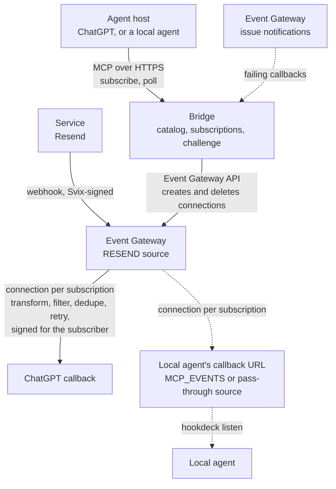

# MCP Events bridge: architecture

Status: draft, revised 27 Oct 2026 for 0.8.0. Repo `hookdeck/mcp-events-bridge`, npm package `@hookdeck/mcp-events-bridge`.

This is the design. The staged plan and its status are in [`PLAN.md`](PLAN.md), and spike results in [`SPIKES.md`](SPIKES.md). Agents working on the repo should also read `AGENTS.md` at the repo root. Read "Mental model" first: the rest of this document assumes it.

Since 0.8.0 (stage 8), Event Gateway delivers each event straight from the service's source, and events no longer pass through the bridge (see "Delivery: Event Gateway delivers"). The relay it replaced is described under "Evolution".

## What it does

The bridge turns a service's ordinary webhooks into MCP Events, for services whose MCP servers don't implement MCP Events yet. In the bridge, each service is a source.

- **Hookdeck Event Gateway** receives and verifies the service's webhooks, turns each into an MCP Event with a transformation the bridge generates, and delivers it to every subscriber, signed for each, with retries and a record of each attempt.
- **The bridge** is the MCP server: the event catalog, subscriptions, the challenge, and one Event Gateway connection per subscription. Until 0.8.0 it also turned each webhook into signed MCP Events itself (the relay).
- **The Hookdeck CLI** is how anything local takes part: a local agent receiving events, or the bridge itself running on a laptop. The hosted path came first (stage 5); local agents are stage 6.

Worked example: Resend inbound email. Someone emails an address on Resend, Resend sends `email.received`, and a ChatGPT dot (or a local agent) subscribed to that event wakes up and acts.

## Goals and non-goals

Goals:

- Events for services that haven't shipped MCP Events, starting with Resend.
- **Hosted first.** The bridge runs as a service with a public MCP endpoint that ChatGPT connects to directly.
- **Local agents through the Hookdeck CLI.** Events reach a laptop through Event Gateway and `hookdeck listen`, including events that arrive while it's offline.
- **Low friction for self-hosters.** Nothing beyond Hookdeck and the services themselves is required: no identity provider, no tunnel service.
- **Built on Hookdeck.** Event Gateway and the Hookdeck CLI do the receiving, delivering and local delivery; where they can't yet, the design says what would close the gap (see "Evolution").
- Setup through a typed config file (`bridge.config.ts`) that a coding agent can edit: "add Resend inbound email".
- Event Gateway as the single record of every service's events, inbound and outbound.
- Events delivered without passing through the bridge: done in 0.8.0 (see "Delivery: Event Gateway delivers").

Non-goals for now:

- **Wrapping services' APIs as tools.** Vendors' own MCP servers do that. Resend's already lists and reads inbound emails. The bridge supplies events only.
- **Hosting the bridge for other people.** That's the multi-tenant product and a separate decision.
- **A required identity provider or tunnel service.** Authentication starts with a shared secret, as a bearer token or in the URL; OAuth and tunnels are optional (see "Authentication").

## Mental model

Two vocabularies meet in the bridge. Keep them apart: MCP Events terms in everything users and agents see (tools, README, skill), Event Gateway terms in this document.

**MCP Events** ([SEP-3415](https://github.com/modelcontextprotocol/modelcontextprotocol/pull/3415)). An MCP client subscribes with `events/subscribe`, giving a **callback URL** (public, `https`) and a **secret** it generated. The MCP server verifies the callback URL, normally with a challenge signed with the secret, delivering nothing until the echo comes back. It signs every delivery with the secret (Standard Webhooks), so the client can check where it came from. The spec doesn't say how a client gets its callback URL.

**The bridge is the MCP server.** It serves the event catalog, takes subscriptions and sends the challenge.

**Event Gateway.** A **source** is a public URL that receives requests and verifies them, by type (`RESEND`, `GITHUB`, `WEBHOOK`, `MCP_EVENTS`, and others). A **destination** is where events go: an HTTP URL, or a **CLI destination**, which `hookdeck listen` forwards to a local port. A **connection** joins a source to a destination, with rules (transformation, filter, dedupe, retry). Each request at a source becomes one event on each connection whose rules it passes.

How they map:

| MCP Events | Event Gateway |
| --- | --- |
| A service's webhooks | The service's source, `bridge-<source id>` |
| A subscription | One connection on the service's source, `mcp-sub-<id>`: a transformation that builds the envelope, a filter for the event and the subscription's arguments, dedupe and retry |
| The callback URL and secret | That connection's HTTP destination, which signs every attempt with the secret |

Every callback URL is public, and the bridge treats them all alike, except that it skips the challenge for a pass-through callback URL it created itself (below).

**Callback URLs for clients that can't provide one** (local development, behind NAT). The bridge has a utility for them, `create_callback_url`. It creates an Event Gateway source whose public URL is the callback URL, with a connection to a CLI destination; `hookdeck listen`, run by the bridge, forwards that to the agent's local port. With the client's secret, the source is an `MCP_EVENTS` source holding it, which answers the challenge and verifies each delivery. Without one, it's a pass-through `WEBHOOK` source that verifies nothing, for clients with a secret per subscription under one base URL. To the MCP server it's an ordinary callback URL: a delivery to it is an HTTP delivery to a source URL.

```text
MCP server:  service ──→ bridge-<source id> (source) ── mcp-sub-<id> (connection) ──→ HTTP destination: the callback URL
Receiver:    the callback URL (MCP_EVENTS or WEBHOOK source) ── connection ──→ CLI destination ── hookdeck listen ──→ the agent's port
```

A callback URL from the bridge isn't a tunnel in the cloudflared or ngrok sense: Event Gateway keeps every request and retries, and one with a secret passes only requests signed with it. Until 0.8.0 it was `create_tunnel_url`, whose source held a secret the bridge generated, and the bridge signed everything to it twice.

## System overview



The challenge at subscribe time is the one thing the bridge sends straight to a callback, because it needs the echo back synchronously. Events never pass through the bridge.

## Delivery: Event Gateway delivers

Since 0.8.0 (stage 8: designed and probed on 22 Oct 2026, after Event Gateway shipped Standard Webhooks destination auth, and built on 27 Oct; see `SPIKES.md`, "Stage 8: Event Gateway delivers"). The relay it replaced is described under "Evolution".

Event Gateway delivers every MCP Event itself, straight from the service's source, signed on every attempt with the subscriber's secret. The bridge serves the catalog, takes subscriptions, sends the challenge, and manages the connections.

### A subscription is one connection

```text
connection:  mcp-sub-<id>, on the service's source bridge-<source id> (RESEND, GITHUB, WEBHOOK, STRIPE, ...)
  rules:     transform    bridge-<source id>-envelope, one per source, shared by its subscriptions
             filter       headers: x-mcp-skip absent; body: { name: <event name>, data: <the arguments' filter> }
             deduplicate  headers.webhook-id, 1 hour
             retry        exponential, [">=300", "!410", "!413"]
destination: mcp-sub-<id>, HTTP, the callback URL, path forwarding off;
             auth STANDARD_WEBHOOKS with the subscriber's secret
description: {"v":2, principal, event, arguments, expiresAt, createdAt, updatedAt, delivery?, ca, rp?}
```

- **The transformation** (`src/core/transformation.ts`) is generated from the source's runtime (see "Source definitions"), and written by `setup` and again when `serve` starts, so it matches the running bridge's version and config. It builds the envelope `{ eventId, name, timestamp, data, cursor }`, sets `webhook-id` to the event id and `X-MCP-Subscription-Id` from the connection's name (`context.connection.name`), and clears the sender's query string (the destination doesn't forward the sender's path either). One transformation serves every subscription on the source: it runs for each subscription's connection, before the filter, so each gets its own subscription id (verified).
- **The cursor** is poll's format (see "Poll mode"), built in the transformation from the connection's description: `ca`, the hash of the subscription's arguments, and the time it runs less the look-back. While a replay runs, the description includes `rp`, where the replay started, and every delivery's cursor starts there instead, so a client that saves the latest cursor never skips past events the replay hasn't sent yet (see "Webhook cursors and replay"). The keys are short because the description holds at most 500 characters, with room left for a delivery failure and a replay marker.
- **The filter** holds the event name and the subscription's arguments: each event's `filter(args)` (`src/core/filter.ts`), matched against the normalized fields the transformation produces, since Event Gateway's matching is case-sensitive and type-strict. The sources' filters use equality, arrays that contain values (Resend's `to`) and `$or` (GitHub's `actions`), which is lifted to the top of the filter's body (verified). The bridge applies the same filter itself in poll mode.
- **Skipped events.** The transformation adds an `x-mcp-skip` header to anything that can't be delivered, and every filter requires it to be absent: an event type the source doesn't offer, a request it can't build an event from, an event id containing a period (Standard Webhooks ids can't have one, and Event Gateway fails such an attempt with `DESTINATION_AUTH_FAILED`), and an envelope over 256 KiB. They're recorded as `FILTERED` (verified). A thrown transformation error would instead open an issue for every subscription on every request.
- **The destination** signs each attempt with `webhook-id`, a fresh `webhook-timestamp`, and a `webhook-signature` over the exact body (verified, including manual retries and request retries). That closes the retry gap (conformance row 56), and subscription retries no longer have to fit inside 5 minutes.

The connection's description is the subscription's record, as before (see "Data model"); its secret is only in the destination's auth.

### The secret

1. The client calls `events/subscribe` with its callback URL and its secret.
2. The bridge, as the MCP server, sends the challenge to the callback URL, signed with that secret only.
3. The secret goes on the subscription's destination (`STANDARD_WEBHOOKS`, `webhook_secret_key`), and Event Gateway signs every attempt with it. The bridge reads it back at startup, with the rest of the subscription.
4. A refresh with a new secret updates the destination's key at once. The SEP's SHOULD, signing with the old and new secrets for a grace window (row 51), needs Event Gateway to accept a second, expiring key on a destination (its signer already takes several).

### What the bridge stopped doing in 0.8.0

- The relay's delivery path, the topic sources (`bridge-out-*`), and the Publish API for live events (replay still publishes, through a temporary connection to the subscription's destination: see "Webhook cursors and replay").
- Its own inbound connection for service events (`bridge-<source id>-<deployment>`), its inbound route for them, and their recovery. Poll mode, `get_event` and `list_events` read Event Gateway's request listing, as before. Issue notifications keep `/inbound/hookdeck`.
- Signing deliveries, holding a secret of its own for callback URLs, re-sending missed deliveries, and `CUSTOM_SIGNATURE` destinations (and with them the `x-mcp-bridge-hmac` header).
- Checking `x-hookdeck-verified` on a generic webhook's requests: a source without its credentials verifies nothing, so `serve` refuses to start until they're set, and nothing can subscribe to its events meanwhile.

### Expiry

The sweeper deletes an expired subscription's connection and destination, on its interval. Event Gateway keeps delivering until then, so a bridge that's asleep (a laptop) deletes them late, and its expired subscriptions keep receiving until it wakes.

### Callback URLs from the bridge

`create_callback_url` (`src/core/callbacks.ts`), offered by a bridge with CLI inbound, the one on the agent's machine. Its `secret` is the one the client subscribes with, and its caller is the client's own code or a setup step, not the model: tool arguments are written by the model, and MCP has no way to keep one from it (the spec's channel for sensitive values, URL-mode elicitation, collects them from a person). `mcp-events-bridge callback-url create` (`src/host/callback-url-cli.ts`) calls the tool on the running bridge over MCP, reading the secret from an environment variable so it never appears in a command line.

1. **With a secret,** it creates an `MCP_EVENTS` source holding it. A new source's secret works at once. The client subscribes with the URL and the same secret, the source answers the challenge, and a client that subscribes with a different secret fails it (`CallbackEndpointError`).
2. **Without one,** it creates a `WEBHOOK` source with no verification: pass-through. The client subscribes with the URL, or a path under it, and its own secret. Neither Event Gateway nor the client answers a challenge sent to it (a plain source answers every request with its own response), so the bridge verifies the URL out of band instead, as SEP-3415 allows: it created the URL, for this agent. It logs `warning: <name> is a pass-through callback URL: ...` at subscribe, and the receiver checks every delivery's signature.
3. Either way, a connection joins the source to the agent's CLI destination (no auth: the delivery's own signature passes through), and `listen` forwards each delivery to the agent's port.
4. Deliveries missed while the agent's `listen` is down (the laptop asleep) are retried by retrying the subscription's own Event Gateway event, which Event Gateway signs afresh (see "Missed deliveries").

- **One callback URL holds one secret.** A client with one secret uses one URL, as its base if it likes; a client with a secret per subscription uses a URL per subscription. Released Hermes (v0.22.5), and the AI SDK, Mastra and TanStack AI libraries, are neither: a secret per subscription, under one base URL. They get a pass-through URL. That's conformant on their side: the SEP's receiver checks a delivery against the secrets registered with it. The limit is Event Gateway's single secret per source (see "Open questions").
- **Rotation means a new callback URL, for now.** A changed source secret takes about 61 seconds to reach Event Gateway's edge, and deliveries signed with the new secret are refused until it does. A new source's secret works at once, and the old URL is deleted after an hour unused. Once destinations accept a second key and sources several, rotation can happen in place.
- **The bridge's own checks.** Callback URLs from the bridge are always challenged at subscribe (never from the verification cache), unless pass-through, and a deleted URL's cached verification is dropped, so a subscription can't be recreated on a deleted source.

### Migration from 0.7

`src/core/migrate.ts`. `setup` finds data from 0.7 and asks before migrating it; `serve` asks in a terminal and otherwise refuses to start; `--migrate` on either migrates without asking ([`UPGRADING.md`](UPGRADING.md)).

- **Found:** `mcp-sub-*` connections with version 1 metadata, callback connections with version 1 metadata, `bridge-out-*` topic sources, and this deployment's inbound connections (`bridge-<source id>-<deployment>` on a source in the config).
- **Callback URLs first:** each source is upserted by name as `WEBHOOK` with no auth, keeping its id and URL (verified), and its connection's metadata becomes version 2, pass-through. The edge takes about a minute to accept unsigned requests; deliveries it refuses meanwhile are retried by the subscriptions' connections.
- **Subscriptions:** each is read (metadata, and the secret and URL from its `CUSTOM_SIGNATURE` destination) before anything is deleted, so one that can't be read stays as it was. Then its connection and destination are deleted and it's re-created on the service's source with the same id, URL, secret, arguments and expiry. An expired one, or one for an event the config no longer offers, is only deleted.
- **Then** the topic sources nothing is on any more, and this deployment's inbound connections and their destinations. Another deployment's inbound connections are left for it to migrate.
- Subscriptions and callback URLs are project-wide, so the first deployment to migrate moves them all.
- **Versions after 0.8.0:** each transformation's first line names the bridge version that wrote it (`// Generated by mcp-events-bridge 0.8.0 for the source ...`; `GET /transformations?name=` returns the code, verified 28 Oct). One written by a newer version is part of the migration plan, so a bridge doesn't silently replace the event mapping a newer bridge sharing the project depends on; one written by an older version is an upgrade, and is updated with a log line.

### Not taken

- **Publish once per topic** (the plan before stage 8): it needs the same transformation and filters as delivering from the service's source, and keeps the relay.
- **A subscription connected straight to a CLI destination:** it skips the callback URL the client gave.
- **Loopback callback URLs** (an agent giving its local URL, with a CLI destination per subscription): the SEP requires `https` (row 94), and there's no need, since a callback URL the bridge creates is a source's public URL.
- **A connection kept per source for history:** Event Gateway keeps every request on the source whether or not a connection takes it, so replay and poll read the request listing. (Replay can't retry those requests into a new subscription's connection, though: see "Webhook cursors and replay".)

## Evolution

### Before 0.8.0: the relay

Until 0.8.0 every event passed through the bridge, between two Event Gateway sources, holding no event state:

1. The service sent its webhook to its source (`bridge-<source id>`), and Event Gateway verified it.
2. An inbound connection per deployment (`bridge-<source id>-<deployment>`, deduping on the service's event id and retrying linearly within the hour) delivered it to the bridge's inbound route, `/inbound/<source id>`, which checked the Hookdeck signature.
3. The bridge mapped the request with the source's manifest, matched it against live subscriptions (each event's `accepts()`), signed an envelope for each match with that subscriber's secret, and published it to the event's `PUBLISH_API` topic source (`bridge-out-<event name, slugged>`) with `X-MCP-Subscription-Id`.
4. Each subscription was a connection from the topic source, filtering on its own id, with dedupe and retry, to a `CUSTOM_SIGNATURE` destination at the callback URL, which held the secret.
5. If every publish succeeded the bridge answered `200`; otherwise `5xx`, and Event Gateway retried the inbound event, which dedupe on `webhook-id` absorbed for the subscribers already published to.

It worked, and Event Gateway was the store on both sides, but Event Gateway passed the published headers through unchanged, so every retry had the first signature and timestamp (conformance row 56): retries had to fit inside the 5 minutes receivers accept. A secret rotation's grace window was kept in memory. Standard Webhooks destination auth (below) removed the reason for the relay.

### When Event Gateway signs Standard Webhooks

This needed a Standard Webhooks destination auth type in Event Gateway.

Status: shipped on 21 Oct 2026, for HTTP and CLI destinations (`auth_type: STANDARD_WEBHOOKS`, `auth: { webhook_secret_key }`), and verified in production on 22 Oct (see "Verified facts"). Stage 8 (0.8.0) builds on it and goes further than the plan below: it skips publishing once per topic and delivers straight from the service's source (see "Delivery: Event Gateway delivers").

What the feature had to do, for this design, and what shipped:

- sign `webhook-id.webhook-timestamp.body` with a `whsec_` secret held on the destination, producing `webhook-id`, `webhook-timestamp` and `webhook-signature`: **shipped**;
- sign fresh on every attempt, with `webhook-id` stable across attempts: **shipped**;
- take `webhook-id` from the request (a header such as `webhook-id`, or a body field), so it stays the provider's event id; Event Gateway's own event id differs per connection, so it can't be used when one request fans out to several subscribers: **shipped**, from the request's `webhook-id` header (which a transformation can set), else Event Gateway's event id;
- sign with both the old and new secret for a grace window after rotation (space-separated `v1,` signatures): **not yet**, one key per destination;
- allow a header prefix other than `webhook-`, as Standard Webhooks permits: **not yet**, and MCP Events doesn't need it;
- validate the destination address at delivery time and not follow redirects, per the spec's SSRF rules: **unknown**, as before (conformance rows 80 and 81).

The plan before stage 8 was to change the topology in place:

| | Now | With destination signing |
| --- | --- | --- |
| Publishes per event | One per matching subscriber | One per topic |
| Subscription connection filter | `X-MCP-Subscription-Id` | The subscription's arguments, e.g. `from` |
| Destination auth | None; the bridge signs | Standard Webhooks with the subscriber's secret |
| Partial-failure duplicates | Possible; dedupe absorbs them | Gone: one publish is accepted or not |
| Outbound retry window | Under 5 minutes | Normal; fresh signature per attempt |
| Subscriber secrets live in | The bridge | Event Gateway destinations |
| `FILTERED` records mean | Not this subscription | This subscriber's filter didn't match |

Matching moves into Hookdeck filter syntax, which has no regex and no documented case-insensitive matching. The bridge still builds the envelope, so it adds normalized fields before publishing (for example a lowercased bare `fromAddress` parsed from `Name <addr>`), and connection filters use only `$eq` and `$in`. Each manifest declares how its subscribe arguments map to a filter, and subscribe rejects arguments it can't express.

### Hookdeck capabilities that would simplify the design

| Capability | What it would replace or enable |
| --- | --- |
| Standard Webhooks destination auth in Event Gateway | Shipped 21 Oct 2026. Spec-conformant signing on every attempt, and delivery straight from the provider's source (stage 8) |
| A second, expiring key on Standard Webhooks destinations | Signing with the old and new secrets after a rotation (row 51), and rotating a callback URL's secret without creating a new URL |
| An MCP Events source type, answering the challenge at the source | Shipped 6 Oct 2026. Local agents receiving through the Hookdeck CLI, and the e2e test subscribers without a tunnel (see "Local agents and the bridge on a laptop") |
| CLI redelivery of events missed while a session was disconnected | The bridge's retry of missed deliveries, which finds and retries each subscription's event (see "Missed deliveries") |
| CLI sessions that pick up newly matching sources ([hookdeck-cli#467](https://github.com/hookdeck/hookdeck-cli/issues/467)) | Restarting `listen` after each new callback URL, and the retry that covers the restart |
| An MCP Events source holding several secrets (verifying against any of them, or selected by `X-MCP-Subscription-Id`) | Pass-through callback URLs: a client with a secret per subscription under one base URL (Hermes, the client libraries) would get a URL that answers the challenge and verifies every delivery, as the spec's receiver model expects |
| Source updates that take effect at once (a secret or type change took 61 seconds to reach ingestion) | Rotating a callback URL's secret by creating a new URL, and the minute of refused (then retried) deliveries when the migration makes a 0.7 callback URL pass-through |
| A sequence number on the request listing that only increases | Poll mode's 60-second re-read window and the ids its cursor holds: a cursor could be one number, with no requests missed however late they appear |
| A request/response mode for the Hookdeck CLI | The cloudflared tunnel for a local MCP endpoint, which needs synchronous responses |

### Outpost for delivery (future option)

Hookdeck Outpost already delivers Standard Webhooks with a fresh signature on every attempt, one destination per subscription, and retries; the Outpost demo passed OpenAI's MCP Events checklist that way on 1 Oct. Using it for the bridge's outbound side would close the re-signing gap today. It's a future option rather than the default because it adds a second service to run or sign up for, and the design keeps Event Gateway as the single product and the single record.

### Research: deliver straight from the provider source

Status: answered on 22 Oct 2026, and adopted as stage 8 (see "Delivery: Event Gateway delivers"). Signing is solved by Standard Webhooks destination auth. A transformation shared by every subscription's connection reads the connection's name, so it can set each subscription's `X-MCP-Subscription-Id`, and filters on its output express every provider's arguments today. A transformation error becomes a `TRANSFORMATION_FAILED` ignored event, which a transformation issue trigger can report to the bridge (not yet tried). The original analysis follows.

The further step: attach each subscription's connection to the RESEND source itself, with a transformation that builds the envelope. Resend then reaches the agent through Event Gateway alone, and the bridge is control plane only (catalog, subscribe, challenge, connection lifecycle).

Nothing in MCP Events requires the MCP server to be the sender. A delivery is a webhook signed with the subscriber's secret; the signature is what the subscriber checks. The problems are practical:

- **Signing.** Best done by Standard Webhooks destination auth, which doesn't exist yet. Signing inside a transformation is possible: the runtime has the `crypto` built-in (`createHmac`, and WebCrypto's `crypto.subtle`), and handlers can be async within the 1-second limit (re-checked 13 Oct). It still falls short: the transformation runs once per event, so retries reuse the first timestamp and signature, and the subscriber's secret has to reach the transformation, for example as an environment variable.
- **Per-subscription values.** One shared transformation is enough. Transformations can be shared between connections, and the handler's `context.connection` is the connection object (as `GET /connections/:id` returns it). So it reads the subscription ID for `X-MCP-Subscription-Id` from the connection's name (`mcp-sub-<id>`), and the subscription's event name and arguments from its description, the metadata the bridge already writes there.
- **Mapping runs in the transformation sandbox.** The manifest's `summarize` has to exist as transformation code: no IO, and 1 second including time spent awaiting. Providers whose webhook is too thin and needs an API call to build the event can't use this path; they keep the relay. Resend's `email.received` is metadata-only and would fit.
- **Two copies of the mapping.** The TypeScript manifest (catalog, schemas, tests) and the transformation code must agree. Lean: generate the transformation from the manifest and run the same code under vitest.
- **Failures happen outside the bridge, and notifications bring them back.** A transformation error becomes a `TRANSFORMATION_FAILED` ignored event and opens a transformation issue. With a transformation issue trigger, the bridge hears about it through the issue notifications it already receives (see "Problem feedback from Event Gateway"), and can tell the subscriber, for example with a `gap` control envelope, since events were skipped. To check: whether a transformation issue identifies the connection, which a shared transformation needs.
- **Filter expressiveness.** As above: arguments must map to Hookdeck filters, with normalization done in the transformation (rule order: transformation, filter, dedupe, retry).
- **Size.** The 256 KiB payload limit has to be enforced in the transformation.
- **What stays the same:** `get_event` and `list_events` already read from Event Gateway; the challenge is already sent by the bridge; expiry and unsubscribe already delete connections.

To answer before committing to it: whether a transformation issue identifies the failing connection, and where a transformation gets each subscriber's secret until Event Gateway signs Standard Webhooks. Answered (13 Oct): a transformation can be shared across connections and reads per-connection values from `context.connection`, so a per-subscription static header isn't needed. (Event Gateway documents no limits on the number of connections.)

## Problem feedback from Event Gateway

Event Gateway does most of the delivering, so the bridge needs to hear about problems it no longer sees directly. It uses Event Gateway's own issues and webhook notifications, delivered through Event Gateway like any other event:

```text
issue triggers ──> issue.opened / issue.updated ──> source bridge-hookdeck-notifications
  ──> connection bridge-notifications-<deployment> ──> https://<bridge>/inbound/hookdeck
```

Issue triggers, scoped by name pattern:

| Issue type | Scope | What it tells the bridge | Bridge action |
| --- | --- | --- | --- |
| Delivery, `final_attempt` | connections `mcp-sub-*` | A subscriber's callback is failing, with the response status (in practice from the project's default `first_attempt` trigger; see "Verified facts") | `410`: nothing, since the receiver rejected that one delivery and SEP-3415 says it MUST NOT affect the subscription (the retry rule already skips it). Otherwise record it on the subscription, surface it in `list_sources` and `bridge doctor`, and return it in `deliveryStatus`. Then resolve the issue so the next failure notifies again |
| Request, rejection causes | sources `bridge-*` | The service's requests fail verification, e.g. a rotated Resend secret | Logged. Later: mark the source unhealthy; `bridge doctor` suggests re-running `bridge setup` |
| Backpressure | destinations `bridge-*` | The bridge is slow or down | Operator alert only |
| Transformation, `log_level` `fatal` | the sources' transformations (no trigger set up yet) | Mapping failed, so a subscriber missed events | Logged today, like any non-delivery issue. Later: mark the subscription unhealthy, and tell the subscriber (for example a `gap` control envelope) |

Notes:

- Webhook notifications are set per project (`PUT /notifications/webhooks` with `topics` and `source_id`). This project is dedicated to the bridge, so that's fine; in a shared project it would need agreeing.
- A delivery issue is aggregated per connection and response status (`aggregation_keys`: `webhook_id`, `response_status`, `error_code`). While it's open, further failures with the same key don't notify again, so the bridge resolves the issue (`PUT /issues/{id}` with `RESOLVED`) after acting on it.
- `issue.opened` includes the connection (`trigger_webhook`, including its `name`, which identifies the subscription), the failing attempt with its `response_status`, and the event (stage 4, `test/fixtures/hookdeck/issue-opened-delivery.json`). Resolving an issue sends `issue.updated`.
- Notifications are Hookdeck-signed deliveries like any other, so the inbound route verifies them the same way.
- New projects come with default issue triggers. `bridge setup` adds its own, scoped by name pattern; the most specific trigger wins.
- To check: whether every `TRANSFORMATION_FAILED` ignored event opens a transformation issue, and whether the issue identifies the connection. The transformation marks what it can't deliver with `x-mcp-skip` rather than throwing, so this is for bugs. `TRANSFORMATION_FAILED` and `DESTINATION_AUTH_FAILED` aren't among SEP-3415's `lastError` values, so a delivery issue with such an error code is reported as the closest one.

A failing callback can't be told through that callback, so the bridge reports the failure in `deliveryStatus` when the subscriber refreshes. A problem with a working callback, such as a transformation failure, could reach the subscriber as a control envelope.

## Local agents and the bridge on a laptop

Local delivery goes through Event Gateway and the Hookdeck CLI, so a laptop gets Hookdeck's durability: events are kept while it's offline and delivered when it reconnects.

**Scope (decided 7 Oct).** The bridge runs on the same machine as the agent: one bridge per machine, with one owner, in its own Hookdeck project (several bridges in one project would load and act on each other's resources; an optional namespace is [#13](https://github.com/hookdeck/mcp-events-bridge/issues/13)). Poll, push and cursor replay serve clients that can't receive webhooks wherever they run, so they're not part of local support (see "Clients that can't receive webhooks").

**Status.** Built (PR #12, then 0.8.0): callback URLs from the bridge, the bridge running `listen` for agents and retrying their missed deliveries by itself, and cleanup. Hermes Agent v0.22.5 and three client libraries have subscribed through them (26 Oct, on 0.7, through what was then `create_tunnel_url`).

### A local agent receiving events

A local agent subscribes like any other subscriber, with webhook delivery. The catch is that it has no public URL, and the challenge needs a synchronous answer: a plain Hookdeck source answers immediately with its own response, so the echo never comes back and subscribe fails. So the bridge creates the public URLs (see "Callback URLs from the bridge"), and they're offered only by a bridge with CLI inbound, the one on the agent's machine:

```text
agent-<agent>            CLI destination, shared by the agent's URLs (its local port and path, e.g. 3000 and /events)
agent-<agent>-<name>     source + connection to that destination, one per URL:
                         MCP_EVENTS holding the client's secret, or a pass-through WEBHOOK source
```

- **A URL per secret.** A client with one secret can use one URL for all its subscriptions, or one each; a client with a secret per subscription under one base URL gets one pass-through URL. All of an agent's URLs share one CLI destination, so they arrive on one local path and the agent routes them by `X-MCP-Subscription-Id`, which the spec requires so a receiver can pick the right secret. The shared destination also lets a rate limit protect the agent as a whole.
- **Paths under a callback URL.** A callback URL also covers any path under it: the bridge treats `<callback URL>/<path>` as that URL's (for its challenge rules, recovery and sweeping). The source receives at a sub-path, and answers a challenge there, and `listen` forwards the sub-path (probed 7 Oct). This is for clients that build every callback URL from one base URL plus a path, such as Hermes (`<base>/webhooks/<route>`) and the libraries.
- **The bridge runs `hookdeck listen` for the agent** (`src/host/local-runtime.ts`): one process per agent port, at most 10 sources each, with the bridge's own CLI login, so the agent needs no Hookdeck CLI or credentials. A running `listen` only receives the connections it resolved at startup ([hookdeck-cli#467](https://github.com/hookdeck/hookdeck-cli/issues/467) proposes sessions that pick up new sources), so the bridge restarts it when URLs are created or deleted (debounced, and the old process exits before the new one starts, so sessions never overlap), and retries what arrived in between. A process that exits is started again with backoff.
- **One local port and path per agent.** The first URL sets them (default `3000` and `/events`; the path is the shared destination's) and different ones are refused. At most 50 URLs per agent.
- **Status codes stop at the source.** The source acknowledges each delivery, so the agent's own response (a `410` to reject an event, a `5xx` to retry) never reaches the subscription's connection. The agent unsubscribes instead.
- **Cleanup.** The sweeper deletes a URL's source and connection once no subscription has used it for an hour, not the moment one ends: an agent changing a subscription's arguments unsubscribes and subscribes again on the same URL, and an agent may create a URL before subscribing. The agent's destination stays.
- **Identity.** An agent name is a label, not an identity: any client of the owner can create, list or retry for any agent name. That suits one bridge per machine.

### Missed deliveries

With a CLI destination and no session connected, a request at the callback source is kept with an ignored event of cause `CLI_DISCONNECTED`; within roughly 2 minutes of a drop, events are created and then fail without a response. The bridge checks after every (re)connect (the CLI prints "Connected" at startup and after each websocket reconnect), every 5 minutes as a backstop, and again shortly (up to 10 times) while a run isn't up to date, but only while the agent's `listen` is connected: a retry while it's down is only ignored again.

Each run makes two listings since a watermark: the callback source's requests (with headers) and the callback connection's events (`GET /events?webhook_id=`). Ignored events are only looked up for a request that has some and no event. Requests are grouped into deliveries by `X-MCP-Subscription-Id` and `webhook-id`, so every attempt at one delivery is judged together:

- **Delivered** (any attempt `SUCCESSFUL`), **pending** (in flight, or not processed yet) and **settled** (ignored for another reason, such as a filter): left alone.
- **Rejected by the agent** (`FAILED` with a response status): not retried.
- **Missed** (ignored as `CLI_DISCONNECTED`, or `FAILED` with no response): if the subscription still exists and is on this URL, the bridge finds the subscription's own event on its connection (`GET /events?webhook_id=<subscription connection>&headers={"webhook-id":...}`) and retries it (`POST /events/{id}/retry`, which works on a succeeded event; verified 27 Oct). Event Gateway signs the retry afresh with the subscriber's secret and delivers it to the callback URL again, so it works for pass-through URLs too, and the agent's 5-minute timestamp check passes however late it is. Retrying the callback's own request would replay the original timestamp, and a request retry on the subscription's connection would be dropped by its dedupe rule.

A retried event takes a few seconds to reach the callback source and appear in its listing, so for 3 minutes after a retry the delivery counts as pending rather than being retried again. The watermark (in the connection description) moves to two minutes before the run, only after a run that retried nothing and found nothing pending, so a run while `listen` is still offline, or racing Event Gateway's processing, loses nothing. Delivery is at least once; agents dedupe by `webhook-id`, as the spec asks. A delivery whose event Event Gateway no longer keeps is logged and skipped.

**Retry, not replay.** In the spec, a *retry* is the sender attempting the same event again (same `eventId` and `webhook-id`, a new request with its own timestamp), and *replay* is the client asking, with a cursor, for events from a past position. This job retries deliveries lost on the way to the laptop; cursor replay is separate (see "Webhook cursors and replay").

### The bridge's own inbound on a laptop

Events don't reach the bridge, but Event Gateway's issue notifications do (see "Problem feedback from Event Gateway"). On a laptop (CLI inbound), `setup` gives the notifications connection a CLI destination at `/inbound/hookdeck`, and `serve` runs `hookdeck listen <port> bridge-hookdeck-notifications`. Before starting it, `serve` checks that the connection exists, on the right source, with a CLI destination at the right path, and that each service source exists, and fails closed otherwise: `listen` would create a default `<source>-cli` connection for a source without one. Requests forwarded by the CLI have the same Hookdeck signature as HTTP deliveries (stage 2), so the inbound route doesn't change.

- **Supervising `listen`:** `serve` logs the CLI in with its own key (`hookdeck ci` into a private config), waits for the first "Connected", and restarts `listen` with backoff if it exits.
- **Recovering missed notifications** (`src/core/inbound-recovery.ts`, ported from the fleet demo's `recover.ts`): while the laptop sleeps, notifications wait on the bridge's connection as `CLI_DISCONNECTED` (or, within about 2 minutes of the drop, as events that failed without a response). After every (re)connect, and on the same timer while connected, the bridge retries them for its own connection only (`POST /requests/{id}/retry` with `webhook_ids`, or `POST /events/{id}/retry` for a settled failed event). Each run filters on the connection: one listing of its events, and the source's requests that have ignored events (`ignored_count[gt]=0`; Event Gateway has no listing of ignored events across requests), the only ones looked at one by one. Nothing is retried again within 3 minutes. The watermark is kept in a small file next to the CLI config, so a bridge started again after a weekend checks from where it stopped (the first run looks back a day). Until 0.8.0 this recovered the service events the bridge relayed, too.

A local agent on the same machine connects to the bridge's MCP endpoint on `127.0.0.1`. ChatGPT can't reach a local bridge's MCP endpoint without a public URL with synchronous responses, such as a cloudflared tunnel (see the README's quick start).

### Clients that can't receive webhooks

- **Poll** (`events/poll`): built (8 Oct, [#26](https://github.com/hookdeck/mcp-events-bridge/issues/26)), below. Backed by Event Gateway's stored requests, with the cursor as a position in that history, so it also gives catch-up and replay. Hosts without MCP Events support (Claude Code, Codex CLI, Cursor) get the same implementation as tools.
- **Push** (`events/stream`): later, only if a client needs it. With the bridge on the same machine, a push-only client would connect over `localhost` and need no tunnel, though events would skip Event Gateway's delivery records.

### Webhook cursors and replay

Built 27 Oct ([#50](https://github.com/hookdeck/mcp-events-bridge/issues/50)) in the relay, and moved into Event Gateway in 0.8.0. Webhook delivery uses poll mode's cursor (below), a position in Event Gateway's history of the source's requests, so a webhook subscriber can catch up as a poll client does.

- **Deliveries:** the transformation gives each delivery a cursor: the time it runs less the look-back, with the subscription's arguments hash (`ca` in the connection's description). Replaying from it re-reads the last minute rather than risk skipping an event still in flight, so the event just delivered can come again.
- **Subscribe:**
  - A new subscription, or one that had expired, made with a cursor replays from it in the background (`src/core/replay.ts`). The subscription is written with `rp`, where the replay starts, so its deliveries have that position as their cursor until the replay is done. The bridge pages through poll's listing from the cursor (so the events are the ones poll would return), and Event Gateway delivers them: while the replay runs, a connection `bridge-replay-<subscription id>` joins the bridge's `PUBLISH_API` source `bridge-replay` to the subscription's own destination (by `destination_id`), with a filter on `X-MCP-Subscription-Id`, dedupe on `webhook-id` and the subscription's retry rule. The bridge builds each event's envelope with the source's runtime (cursor: the replay's start) and publishes it with `webhook-id` and `X-MCP-Subscription-Id`; the destination signs every attempt with the subscriber's secret. It waits out rate limits, then waits (up to 10 minutes) for the replayed events to settle, deletes the replay connection and clears `rp`. The response echoes the client's cursor.
  - **Why not retry the stored requests:** Event Gateway retries a request only for the connections it was routed to when it arrived, and a new subscription's connection wasn't one (verified 27 Oct: a scoped and a full request retry both created no event for a connection made after the request).
  - A refresh of a live subscription treats its cursor as a no-op, as SEP-3415 says, and answers a fresh watermark. While its deliveries are failing, the client's cursor stands instead, so persisting the answer never skips an event Event Gateway is still retrying.
  - `truncated` is true only for a cursor older than Event Gateway's retention.
- **Repeats:** a live event can arrive during a replay (it comes through the subscription's own connection, the replayed copy through the replay connection, so neither's dedupe sees the other), and a replay re-reads the minute before its cursor, so receivers dedupe by `eventId`, as for any delivery.
- **Interrupted:** a replay runs in the bridge. If the bridge restarts part way, the rest isn't sent, and the client's next refresh is a no-op on its now live subscription. At startup the bridge deletes leftover `bridge-replay-*` connections and clears stale replay markers.
- **Verified live** (27 Oct, on 0.7, the e2e's step 6): a fill sent while nothing was subscribed reached a new subscription made with the last delivery's cursor; another symbol's fill wasn't replayed.
- **ChatGPT:** OpenAI's guide says ChatGPT refreshes "using the same subscription identity and the last saved cursor". Pausing and resuming a task isn't that (tested 27 Oct on 0.7.0): pausing unsubscribes, and resuming subscribes again with a new callback URL (so a new subscription id) and `cursor: null`, which SEP-3415 defines as "start from now". An email sent while the task was paused wasn't delivered or replayed. Replay would help ChatGPT on a refresh with its saved cursor, which a 30-day grant makes rare and which hasn't been seen yet.

### Poll mode

Designed 8 Oct ([#26](https://github.com/hookdeck/mcp-events-bridge/issues/26)) from the spike in `SPIKES.md` ("Poll mode: Event Gateway's request listing"), and revised after a review. Built (8 Oct): `src/core/poll.ts`; see `SPIKES.md` ("Poll mode: acceptance") for the runs with real clients.

**A proxy to Event Gateway.** Polls are answered from Event Gateway's request listing, with no event store in the bridge: the cursor holds the position. Event Gateway is the store, as it is for `get_event`, `list_events` and replay, and a poll works whether or not any connection took the request. Events reach a poller about 2 seconds after Event Gateway receives them (up to 15 measured).

**Request and result,** as in SEP-3415: `events/poll { name, arguments, cursor, maxAgeMs?, maxEvents? }` returns `{ resultType: 'complete', events, cursor, truncated, hasMore, nextPollMs }`.

- Each event is `{ eventId, name, timestamp, data }`: a webhook delivery's body without `cursor`.
- `maxEvents` defaults to 50; larger values are lowered to 100.
- `nextPollMs` is 2000, 0 with `hasMore`, and more under back-off (below), with `hasMore` too.
- An unknown name is `NotFound`, as for `events/subscribe`. `arguments` are parsed by the event's `parseArguments`, as subscribe does. A cursor that can't be read, or is for another name or arguments, is invalid params.
- `events/list` adds `"poll"` to each event's `delivery`. The server advertises both `capabilities.events` (read by ChatGPT and pi-mcp-events) and `extensions["io.modelcontextprotocol/events"]` (SEP-3415).

**The client polls, not the bridge.** `events/poll` and the `poll_events` tool answer once per call, and the client decides when to call again (after `nextPollMs`, or at once with `hasMore`). The bridge runs no timer. The one exception is `wait_for_event`, which polls again after each `nextPollMs` (at least 2 seconds) within a single call.

**One shared listing.** The Hookdeck API allows 240 requests per minute per API key, shared with recovery, `get_event` and setup. One poll loop at 2 seconds is 30 a minute, so listings are shared:

- **The live window:** `GET /requests?source_id=<A>&source_id=<B>...&status=accepted&created_at[gte]=<now - L - 65 s>&order_by=created_at&dir=asc&include=data&limit=255`, paged with `next`. Several sources go in one call as a repeated `source_id` (or `source_id[]`); `source_id=A,B` silently returns nothing (verified 8 Oct). It reaches 65 seconds past L because a cursor's watermark is its listing's time less L, that listing can be an interval old when served, and the client waits another interval: two of the longest (30 s) plus a margin for the clock estimate keep a client that polls at `nextPollMs`, even backed off, on the window.
- **Fetched on demand:** a poll that finds the window more than 2 seconds old fetches it, and polls that arrive during a fetch wait for the same one, and share its failure. No polls, no calls. Every poll and `wait_for_event` reads the same window, so live polling costs about 30 calls a minute (more pages at high event rates), however many clients poll, as long as each polls at the `nextPollMs` it's given; a client slower than about a minute and a half catches up instead (below).
- **Only polled sources:** the window lists the sources polled in the last 60 seconds. A poll for a source not in the window adds it and fetches the window again at once; a source no poll has asked for in 60 seconds is dropped at the next fetch.
- **Catch-up:** a poll whose watermark is older than the window (after a gap, or draining a backlog) lists its own source from its watermark, at most two pages, and returns `hasMore` if there's more. Its rate limit feeds the back-off, and there's no catch-up while backing off.
- **Back-off:** the bridge tracks `X-RateLimit-Remaining`. Below a quarter of the limit, the window's refresh interval and `nextPollMs` grow, up to 30 seconds, and come back to 2 seconds as it recovers; a backlog then drains at that pace, not at once. A `429` (on the window or a catch-up) doesn't fail a poll: it's answered from the existing window if that covers the source, or else with no events, the same cursor and `nextPollMs` of 30 seconds. After a failed call, the bridge makes no listing calls for 30 seconds (2 after other errors).

**Which requests are events,** whatever Event Gateway did with each (since 0.8.0; until then poll matched what the relay would have delivered, from each request's events and ignored events on the inbound connection). `status=accepted` drops `VERIFICATION_FAILED`. Then each request is mapped by the source's runtime (as for `get_event`, and as the transformation does), and kept if the event's name matches and its `data` matches the event's `filter(args)` (`matchesFilter`, the same filter as the subscription connection's). A request without `data` that's newer than L is held: it isn't returned, and the watermark doesn't pass it. Repeats are dropped by `eventId`, so a sender's retry with the same id is returned once while the cursor still holds the first's id. An event's `timestamp` is the source's, or else the request's `created_at`.

**The cursor, and late requests.** A request appears in the listing about 2 seconds after its `created_at` (up to 15), and out of order: in the spike, a quarter appeared after one with a later `created_at` was already listed. A cursor at the newest request seen would skip them, so the cursor re-reads a window:

- It's opaque and versioned (base64url JSON): the event name and a hash of the arguments, a floor (nothing created before it is returned), a watermark `w`, the time `t` of the listing it came from, and the ids of requests at or after `w` that it has returned.
- A poll reads the requests from `w` on, and returns those it hasn't returned, in `created_at` order, up to `maxEvents`. The new `w` is `t - L`, but never past an eligible request it didn't return (cut short by `maxEvents`) or one not processed yet. Ids older than the new `w` are dropped. Only returned ids are kept: a request that doesn't match the arguments gets the same answer each time, so the cursor grows with this subscription's events, not the source's traffic.
- `t` is the listing response's `Date` header, Event Gateway's clock, so the bridge's clock doesn't matter. Where there's no listing to read it from (a null cursor, `maxAgeMs` and retention), "now" is the bridge's clock plus the offset measured from the last `Date` header.
- **L is 60 seconds**, four times the slowest appearance measured (15 s, in 120 requests on one afternoon: a measurement, not a guarantee). A request that appears more than L late is missed, with no signal. A sequence number on the request listing that only increases would remove the window ("Hookdeck capabilities that would simplify the design").
- **A null cursor** starts from now, at this poll (not at the window's listing, which can be an interval old): floor now, `w = now - L`, no events. It doesn't need the listing, so a `429` doesn't fail it. `maxAgeMs` is ignored with a null cursor, as the SEP says; for history, use `list_events`.
- **`maxAgeMs`** with a cursor raises the floor to now less `maxAgeMs`, and `truncated` is true if the cursor's last listing is older than that floor.
- **Retention:** when `w` is older than Event Gateway's retention (configurable; 3 days on the Developer plan, 7 on Team, 30 on Growth), the poll starts from the oldest retained request and returns `truncated: true`.
- Delivery is at least once, as the SEP says: clients dedupe by `eventId`.

**Tools,** for hosts without MCP Events support. The spec calls poll "a protocol-level operation", not a tool, so these are an adapter:

- `poll_events(name, arguments?, cursor?, maxAgeMs?, maxEvents?)`: the same as `events/poll`.
- `wait_for_event(name, arguments?, cursor?, timeoutMs?)`: polls at each `nextPollMs` (at least 2 seconds, so it reads the shared window), at once while `hasMore` with nothing matching, with progress notifications, and returns as soon as there are events, or with none and the cursor at `timeoutMs` (default 45 s, at most 50 s: Claude Code's HTTP timer and Codex's tool timeout are 60 s by default).

**Acceptance (#26).** A property test against a fake listing (requests appearing late and out of order, duplicates, unprocessed requests, `maxEvents` from 1 to 100). pi-mcp-events calling `events/poll`. A 10-minute live soak with bursts, wrong signatures and duplicates, with Claude Code calling `wait_for_event` during it. A local bridge with `listen` stopped. A long gap, and concurrent pollers with no `429` reaching a caller.

### Background: `watch` and the Claude Code plugin

Built 9 Oct ([#26](https://github.com/hookdeck/mcp-events-bridge/issues/26), [#45](https://github.com/hookdeck/mcp-events-bridge/pull/45), [#47](https://github.com/hookdeck/mcp-events-bridge/pull/47)). `wait_for_event` holds an agent's turn; between turns nothing polls. Claude Code wakes a session on each line a background command prints (its Monitor tool, and plugin monitors), so a command that polls and prints events is enough.

**`mcp-events-bridge watch`** (`src/host/watch*.ts`) is an `events/poll` client, connected to the bridge over MCP like any other:

- **With event names:** one loop per name, each with its own cursor from now, one JSON line per event (`{ eventId, name, timestamp, data }`), deduped by `eventId`. It waits `nextPollMs` (none with `hasMore`), backs off up to 30 s on failures, and exits on an unknown name or arguments that don't match the inputSchema.
- **With a watch list** (`--list <file>`, or `--store <dir> --project <dir>`): it follows `{ "watches": [{ name, arguments }] }` as it changes (checked every 2 s), saves each watch's cursor (at most every 10 s, and on exit), and resumes from it next time, with `maxAgeMs` of 24 hours. A rejected saved cursor (after an upgrade) restarts from now. Problems an agent should hear about go to stdout as `{ "problem": ... }`: a watch that can't run (it stays stopped), a watch that keeps failing, and the bridge unreachable for about 30 s (only when every watch is failing). Secrets are redacted in every message.
- **`watches add|remove|list`** edits the list under a lock file (Claude runs adds in parallel). `add` checks the name and arguments with a no-cursor `events/poll` first; `remove` also drops the saved cursor, so adding it again starts from now.

**The plugin** (`plugins/mcp-events-bridge`, listed in `.claude-plugin/marketplace.json` as `mcp-events-bridge@hookdeck`):

- A **monitor** (`when: always`) runs `watch --store "${CLAUDE_PLUGIN_DATA}" --project "${CLAUDE_PROJECT_DIR}"` for the whole session, so each project has its own watch list, and a new session first delivers what happened since the last one.
- A **skill** (`watch`) turns "watch…", "stop watching…" and "what am I watching?" into `events-bridge watches …` (pre-approved with `allowed-tools`), and says to read a cut-off line with `get_event`: notifications shorten long lines (seen at around 500 characters).
- The bridge as an **MCP server**, `url: ${user_config.mcp_url}`, a sensitive option kept in secure storage. Monitor commands can't read user config, so a `SessionStart` hook copies it to `${CLAUDE_PLUGIN_DATA}/mcp-url` (mode 0600) for `watch`.
- `bin/events-bridge` runs `npx @hookdeck/mcp-events-bridge@<version>`, or `MCP_EVENTS_BRIDGE_CLI` for a checkout.

Limits: plugin monitors run only in interactive sessions (not `claude -p`); two sessions in one project each hear every event and share the saved cursors; events from more than 24 hours before a session starts are skipped.

### MCP Events clients

Searched on 7 Oct 2026, and updated on 26 Oct, for clients that subscribe (not servers that emit):

| Client | State | Delivery | Fit with the bridge |
| --- | --- | --- | --- |
| ChatGPT | Shipped (29 Sep) | Webhook, to a cloud callback | Verified with the bridge on 6 Oct |
| [Hermes Agent](https://github.com/NousResearch/hermes-agent) | v0.22.5, 23 Oct ([#140121](https://github.com/NousResearch/hermes-agent/pull/140121)); experimental | Webhook, to the gateway's webhook listener (`POST /webhooks/<route>`, one public base URL, a `whsec_` secret per subscription); approval in chat for each subscription | Yes: on 0.8.0 (27 Oct), subscribed through a pass-through callback URL from `callback-url create` (it has a secret per subscription under one base URL), a signed fill started an agent run, unsubscribed; on 0.7 (26 Oct), the same through a tunnel URL. Earlier, its draft pull request [#132908](https://github.com/NousResearch/hermes-agent/pull/132908) (one global secret, still open) worked from 7 Oct |
| [pi-mcp-events](https://github.com/richardanaya/pi-mcp-events) (Pi coding agent) | 0.1.1 | Webhook, poll and push calls as tools; receives no webhooks itself | Poll or push only |
| [Vercel AI SDK](https://ai-sdk.dev/docs/ai-sdk-core/mcp-events) (`@ai-sdk/mcp`) | Experimental | Webhook only; follows the design sketch | Yes, 2.0.84 (26 Oct): list, subscribe, a delivery, refresh and unsubscribe, through a path under a tunnel URL (it adds `?mcp_event_subscription=`), on 0.7; from 0.8.0, a pass-through callback URL. Rejects a delivery whose `webhook-id` isn't its `eventId` (`400`) |
| [Mastra](https://github.com/mastra-ai/mastra/pull/27330) (`@mastra/mcp`) | Experimental, 2.5.0 (21 Oct) | Poll, push and webhook; SEP-3415, reads only the extensions capability | Yes, 2.5.0 (26 Oct, on 0.7): poll, and webhook through a tunnel URL (a pass-through callback URL from 0.8.0) |
| [TanStack AI](https://github.com/TanStack/ai/pull/1816) (`@tanstack/ai-mcp`) | Experimental, 1.0.0 (22 Oct) | Webhook; SEP-3415, reads only the extensions capability; sends `Mcp-Name` on subscribe and unsubscribe | Yes, 1.0.0 (26 Oct), as the AI SDK. Also rejects a delivery whose `webhook-id` isn't its `eventId` |
| [OpenClaw](https://github.com/openclaw/openclaw/pull/165399) | Beta builds from 2026.10.10-beta.1, not stable | Webhook, OpenAI's profile, triggering Automations | Not tested: its callback is a bare HTTPS origin (no path), which a callback URL from the bridge can't be, so it needs its own HTTPS proxy to the gateway's callback path. Asked upstream for a callback base URL with a path ([openclaw#184684](https://github.com/openclaw/openclaw/issues/184684), 26 Oct) |

Claude Code isn't an MCP Events client: it uses the poll tools, and the plugin for events between prompts (see "Background: `watch` and the Claude Code plugin"). Hermes Agent v0.22.5 is the first released local agent that subscribes through the bridge (see the [guide](../skills/mcp-events-bridge/references/hermes-agent.md)); the e2e tests use a mock agent. Before our fixes went into the earlier pull request (#132908), run against the bridge on 7 Oct, Hermes's client code failed every request: its top-level `_meta` makes the message invalid JSON-RPC (`-32600` from the MCP SDK), and with that fixed, subscribe and unsubscribe fail with `name is required`. Hermes uses one public base URL for every subscription, so its callback URLs are sub-paths of one callback URL from the bridge, which the bridge recognizes as that URL's (see "Paths under a callback URL"), and path forwarding on the source works for its path-per-subscription receiver (probed 7 Oct).

### When a public tunnel is used

Anything local is reached through the Hookdeck CLI by default, and a subscriber's callback through an MCP Events source. A plain public tunnel (cloudflared) is used only when the caller needs the local response synchronously. Today that means the spike receivers and the e2e subscribers that test status codes (`410`, `5xx`), whose responses Event Gateway acts on, and a local bridge's MCP endpoint for ChatGPT.

## Authentication

Single tenant: one deployment, one owner. Tiers, from least friction:

| Tier | How ChatGPT (or any MCP client) connects | Extra service | Stage |
| --- | --- | --- | --- |
| **1. Shared secret** (default) | `https://<bridge>/mcp` with `Authorization: Bearer <BRIDGE_MCP_SECRET>`; or, for a client that can't send a header, the secret in the URL, `https://<bridge>/mcp/<BRIDGE_MCP_SECRET>`, with "No Authentication" in ChatGPT | None | 5 (URL), 26 Oct (header) |
| **2. Built-in single-user OAuth** | `https://<bridge>/mcp`; the bridge is its own authorization server, and the owner approves once with an admin password | None | 7 |
| **3. Bring your own identity provider** | `https://<bridge>/mcp`; tokens from the provider, verified against its published keys | Yes, optional | 7 |
| Optional: OpenAI Secure MCP Tunnel | For private-network deployments; `tunnel-client` beside the bridge | Yes, optional | 7 |

**Shared secret.** `BRIDGE_MCP_SECRET` should hold at least 32 random bytes, base64url (the generated one does; the bridge doesn't enforce it). If it's unset, `bridge setup` generates one and says where to set it (for example `fly secrets set`), then prints the `/mcp` endpoint and, for ChatGPT, the full MCP URL. Clients send it one of two ways, both compared in constant time:

- **`Authorization: Bearer <BRIDGE_MCP_SECRET>` to `/mcp`** (26 Oct), the way to use wherever the client can send a header: Claude Code (`--header`, or `headers` with `${VAR}` in `.mcp.json`), Hermes (`headers` with `${VAR}` in `config.yaml`; `MCP_EVENTS_EMITTER_<NAME>_HEADERS` in its earlier pull request), and `watch`. A header stays out of URLs, so out of request logs and client files that store URLs: Hermes's pull request, for one, saved each subscription's URL in a file anyone on the machine could read. The MCP authorization spec requires the `Authorization` header for access tokens and forbids them in the query string; this static secret isn't an OAuth access token, but the reasoning is the same. A missing or wrong token gets `401` with `WWW-Authenticate: Bearer realm="mcp-events-bridge"` and a hint, as the Hookdeck CRM's MCP server does.
- **In the URL, `/mcp/<BRIDGE_MCP_SECRET>`**, for clients that can take only a URL. ChatGPT is one: it offers only OAuth or no authentication, and "can't present custom API keys" (OpenAI's authentication docs, checked 26 Oct). Claude's custom connectors can send a fixed header, but only in a beta for some organizations. The bridge redacts the secret segment in its own logs; a wrong one gets `404`. `BRIDGE_MCP_SECRET_URL=false` (or `auth.secretUrl: false`) turns this form off for a bridge no ChatGPT connects to.

To rotate the secret, change `BRIDGE_MCP_SECRET` and redeploy (ChatGPT then needs the new URL); a `setup --rotate-mcp-secret` helper is planned. Every caller with the secret is the deployment's owner, so there is one principal, `owner`. Built-in OAuth is what takes ChatGPT off the secret URL.

**Built-in OAuth.** For real tokens without a third party: authorization code with PKCE `S256`, the `resource` parameter copied into the token audience, ChatGPT's redirect URIs allowlisted, and client registration by CIMD (Client ID Metadata Documents) or dynamic registration. Built on a maintained library rather than hand-written; which one supports CIMD and resource indicators is still to check. The token subject becomes the principal.

**Bring your own identity provider.** `auth: { issuer, audience, allowedPrincipals }`: standard discovery and signature checks, so any compliant provider works.

## Process model

One service per deployment:

- **One HTTP listener** (`BRIDGE_PORT`): `POST /inbound/hookdeck` (Event Gateway's issue notifications; Hookdeck-signed only, bodies up to 10 MiB, else `413`) and the MCP endpoint at `/mcp` (with the secret as a bearer token, or later OAuth) and `/mcp/<BRIDGE_MCP_SECRET>`: Streamable HTTP, stateless per the 2026-07-28 revision, as in `mcp-events-outpost-demo`. Deployed, it's public; on a laptop it binds to `127.0.0.1`.
- **The subscription index:** in memory, loaded from Event Gateway at startup (see "Data model").
- **The transformations:** written for each source when `serve` starts, so they match the running version and config.
- **The sweeper:** expires subscriptions and deletes their connections and destinations, and deletes callback URLs no subscription has used for an hour.
- **With CLI inbound, `hookdeck listen`:** one process for the notifications source, and one per local agent port, supervised and restarted by the bridge, with recovery after each reconnect (see "Local agents and the bridge on a laptop").
- **A replay in progress,** in memory, with its temporary `bridge-replay-<subscription id>` connection (see "Webhook cursors and replay").

## Module layout

```text
src/
  core/                 runtime-agnostic: fetch, and no node: imports except node:crypto
    sources/            source types; resend.ts, github.ts; source.ts (source({ type }): webhook senders and Event Gateway
                        source types); source-types.generated.ts (each type's credentials, from Event Gateway's OpenAPI spec)
    config.ts           defineConfig, defineSource, env(), config validation
    transformation.ts   each source's Event Gateway transformation, generated from its runtime; the envelope and cursor
    filter.ts           subscription filters: the connection's filter rule, and the same filter applied in the bridge
    placement.ts        where a subscription's connection goes: its source, transformation, filter and cursor fields
    notifications.ts    the inbound route for Event Gateway's issue notifications: delivery state
    migrate.ts          finds and migrates data from 0.7 (subscriptions, callback URLs, topic sources, inbound connections)
    replay.ts           webhook replay: publishes the events since a cursor to the subscription's destination
    catalog.ts          events/list from the configured sources, named {source id}.{event}
    subscriptions.ts    subscribe, refresh, unsubscribe, sweep; challenge; TTL; per-subscription EG resources
    sign.ts             Standard Webhooks signing, for the challenge
    callback.ts         parse and check callback URLs, build the challenge; CallbackTransport interface
    store.ts            SubscriptionStore interface
    event-gateway-store.ts  subscriptions as connections on their sources: metadata in descriptions, secrets in destination auth
    memory-store.ts     for tests
    names.ts            Event Gateway resource names
    hookdeck.ts         Event Gateway API client, and the Publish API (replay)
    mcp.ts              MCP server: tools + hand-registered events/* handlers
    setup.ts            `setup`: the sources, their webhooks and transformations, issue feedback
    inbound-plan.ts     the notifications connection a config implies; `hookdeck listen` arguments
    event-history.ts    get_event and list_events, from Event Gateway's requests
    callbacks.ts        callback URLs for local agents: create, sweep unused, plan listen, retry missed deliveries
    inbound-recovery.ts recover notifications a local bridge missed while its listen was down
    poll.ts             events/poll: a proxy to Event Gateway's request listing, with the cursor as a position in it
  host/
    callback-transport.ts  CallbackTransport over node:http(s) with a pinned, public-only DNS lookup
    server.ts           HTTP listener: the notifications route and the MCP endpoint (the secret, as a bearer token or in the URL)
    callback-url-cli.ts the `callback-url create|list` command: calls the running bridge's tools over MCP
    cli-listen.ts       logs the CLI in; supervises `hookdeck listen` processes (restart, "Connected")
    local-runtime.ts    a laptop bridge's listen processes: notifications with recovery, local agents with retries
    load-config.ts      finds and loads bridge.config.ts (TypeScript through tsx)
    sources-add.ts      `sources add <id> --type <type>`: the source, .env variables and the config entry
    watch.ts            `watch <event...>`: an events/poll client printing one JSON line per event
    watch-list.ts       `watch --list`: a watch list followed as it changes, with saved cursors
    watch-cli.ts        the `watch` and `watches add|remove|list` commands
  cli.ts                setup | serve | sources add | watch | watches | callback-url (planned: setup --prune, doctor)
scripts/
  generate-source-types.ts  regenerates core/sources/source-types.generated.ts
plugins/
  mcp-events-bridge/    the Claude Code plugin: a monitor running `watch`, a skill, the bridge as an MCP server
test/
```

Later: built-in OAuth. (A Claude Code channel adapter was planned and dropped for poll mode and the plugin; see "Background: `watch` and the Claude Code plugin".)

The `core/` boundary keeps a serverless build possible. `node:crypto` is allowed because Workers (with `nodejs_compat`), Deno and Bun support it. Sending to a callback is not: the SSRF guard resolves the host, rejects non-public addresses and pins the connection to the checked IP, which `fetch` can't do. So `core/` calls a `CallbackTransport`, and `host/` implements it with `node:dns` and `node:http(s)`. A serverless host would supply its own. Only the challenge uses it, since Event Gateway makes the deliveries.

### What to reuse

From `hookdeck/mcp-events-outpost-demo` (passed OpenAI's checklist with ChatGPT on 1 Oct):

| File | Use |
| --- | --- |
| `src/server/callback.ts` | `verifyEndpoint` (the challenge), `parseCallbackUrl`, public-address checks with `allowLocal`. Split on port: pure checks to `core/callback.ts`, `postToCallback` and the pinned lookup to `host/callback-transport.ts` |
| `src/server/identity.ts` | `deriveSubscriptionId` for idempotent subscribe |
| `src/server/errors.ts` | MCP Events error codes, including `-32015` for a failed challenge |
| `src/shared/secret.ts`, `src/shared/standard-webhooks.ts` | `whsec_` checks and signing |
| `src/server/subscriptions.ts` | Subscribe, refresh, unsubscribe and sweep; replace the Outpost calls with Event Gateway connection and destination management |
| `src/server/mcp.ts` | The pattern: the SDK has no MCP Events support, so `events/*` are registered by hand |
| `src/client/subscriber.ts` | The test subscriber |
| `scripts/tunnel.ts` | cloudflared quick tunnel, for a development test subscriber's callback |

From `hookdeck/hookdeck-demos/hookdeck/cli-fleet-fanout`:

| File | Use |
| --- | --- |
| `shared/src/hookdeck.ts` | API client and its documented gotchas |
| `per-machine/src/ensure-connection.ts` | Fail closed at boot (done: `serve` checks the inbound connections) |
| `per-machine/src/recover.ts` | Recovering the bridge's own inbound after a disconnect (done: `core/inbound-recovery.ts`) |
| `shared/src/machine.ts` | How `listen` is spawned and "Connected" detected (done: `host/cli-listen.ts`, with restarts) |

Also: `hookdeck/webhook-skills` for per-provider event lists and verification details. (`hookdeck/claude-channel-plugin` was for a channel shim, no longer planned.)

## Configuration file

The bridge is a technical product: whoever runs it configures credentials and deploys it. Configuration is a typed file, `bridge.config.ts`, and it's the single source of truth for which sources are set up. Setup "from an agent" means a coding agent editing this file and running `bridge setup`, not MCP tools.

```ts
// bridge.config.ts
import { defineConfig, env } from '@hookdeck/mcp-events-bridge';
import { github, resend, source } from '@hookdeck/mcp-events-bridge/sources';
import { acmeCrm } from './sources/acme-crm';     // custom, written with defineSource

export default defineConfig({
  deployment: 'prod',
  sources: [
    resend({ apiKey: env('RESEND_API_KEY'), events: ['email.received'] }),
    github({
      id: 'github-hookdeck',                      // source id; defaults to the type
      token: env('GITHUB_TOKEN'),
      scope: { org: 'hookdeck' },
      events: ['issues', 'pull_request'],   // offered as github-hookdeck.issues, ...; subscribers filter by action, e.g. ['opened']
    }),
    source({ type: 'stripe', secret: env('STRIPE_WEBHOOK_SECRET'), events: ['invoice.paid'], eventType: { field: 'type' }, eventId: { field: 'id' } }),
    acmeCrm({ webhookSecret: env('ACME_WEBHOOK_SECRET'), events: ['contact.created'] }),
  ],
  auth: { mode: 'secret-url' },                    // later: 'builtin-oauth' or { issuer, audience, allowedPrincipals }
  subscriptions: { defaultTtlMs: 30 * 24 * 3600_000 },
});
```

- **Secrets are `env()` references only,** so the file can be committed and reviewed.
- **Each source entry is an instance** with an `id` (letters, digits, `-` and `_`, and not `hookdeck`, which is the notifications route), so one deployment can have several of the same kind (two Resend accounts, several GitHub orgs). Event Gateway resources are named after the instance id.
- **Sources are code.** `resend()`, `github()` and `source({ type })` ship with the package; a deployment adds its own with `defineSource` and redeploys, with no fork and no bridge release. ("Provider" was the name before 0.6.0; see the 26 Oct decision.)
- **The config is loaded at startup.** A TypeScript config is imported through `tsx`'s API (`tsImport`), so it works from source and from the published package, which ships compiled JavaScript in `dist/`. A serverless build would bundle the config as an ordinary module, so the `core/` boundary is unaffected.

Applying it:

- **`bridge setup`** upserts each instance's source and transformation, registers its webhook where the service has an API for it, and offers to migrate data from 0.7. Idempotent.
- **`bridge serve`** checks the config against Event Gateway at startup: it refuses to start with 0.7 data (unless `--migrate`) or a source's credentials missing, and with CLI inbound fails closed if a declared instance isn't set up; with HTTP inbound it warns.
- **Planned (stage 7): `bridge doctor`** to report drift and unhealthy instances (see "Problem feedback from Event Gateway").
- **Removing an instance from the file deletes nothing.** Planned (stage 7): `bridge setup --prune` to clean up, so a bad deploy can't unregister webhooks by accident.

The bridge ships as the npm package `@hookdeck/mcp-events-bridge` with a CLI binary, `mcp-events-bridge`; the repo `hookdeck/mcp-events-bridge` holds the package and examples.

## Data model

No database. Event Gateway is the store, so the bridge is stateless and needs no volume:

- **Events:** never stored by the bridge; Event Gateway is the record of every event.
- **Subscriptions:** one connection each, `mcp-sub-<id>`, on the service's source, to an HTTP destination at the callback URL (see "A subscription is one connection"):
  - **connection description:** readable JSON metadata, so the operator can see it in the dashboard: `{"v":2,"principal":…,"event":…,"arguments":…,"expiresAt":…,"createdAt":…,"updatedAt":…,"ca":…}`, plus `delivery` while it isn't healthy and `rp` while a replay runs. At most 500 characters; subscribe rejects arguments that don't fit with both of those added.
  - **destination auth:** the subscriber's secret, as `STANDARD_WEBHOOKS` config, which Event Gateway signs every attempt with. Masked in the dashboard and in every listing, returned only by `GET /destinations/{id}?include=config.auth`.
- **Sources:** found by name, `bridge-<source id>`, with the service's webhook id in the source description, and each source's transformation, `bridge-<source id>-envelope`.
- **Replay:** the `PUBLISH_API` source `bridge-replay`, and a connection `bridge-replay-<subscription id>` while a subscription's replay runs (deleted after, and at startup if left over).
- **Callback URLs from the bridge:** connections `agent-<agent>-<name>` with version 2 metadata (`kind: "mcp-events-callback"`, the agent, port, path, `passThrough`, and the watermark for missed deliveries).

At startup the bridge lists `mcp-sub-*` connections, reads each destination's secret, and builds an in-memory index; subscribe, unsubscribe, refresh and issue handling keep it current. That assumes one bridge instance per deployment, which fits single tenancy. A description edited into something unreadable is skipped and reported at startup, and one with version 1 metadata (0.7) is counted for the migration and not served.

The description format is versioned (`{"v":2,…`) so a sealed, encrypted format could be added later, for example for multi-tenant hosting, and told apart when reading. Version 1 was 0.7's: a connection on a topic source, with the secret in a `CUSTOM_SIGNATURE` destination (which added an `x-mcp-bridge-hmac` header to every delivery) and a rotation's previous secret only in memory.

## Source definitions

Definitions describe events. They don't wrap services' APIs, apart from registering the webhook at setup. Built-in and custom sources are both written with `defineSource`, which returns the factory used in the config file. `src/core/sources/types.ts` has the full types.

```ts
const resend = defineSource({
  type: 'resend',
  displayName: 'Resend',
  sourceType: 'RESEND',                  // Event Gateway source type
  eventIdHeader: 'svix-id',              // to find an event's request in Event Gateway, for get_event
  events: [/* SourceEvent: name, description, inputSchema, parseArguments, filter, payloadSchema */],
  runtime: resendRuntime,                // (config) => { [event name]: EventRuntime }
  runtimeConfig: undefined,              // JSON, passed to the runtime
  register?(ctx): Promise<{ webhookId: string; signingSecret: string }>,
  unregister?(ctx): Promise<void>,
  sourceConfig?(options), missingCredentials?(options), setupHint?(ctx), ...
});

interface EventRuntime {
  matches(req: InboundRequest): boolean;     // req: { headers (lower-cased), body, receivedAt? }
  eventId(req: InboundRequest): string;      // stable service id
  occurredAt(req: InboundRequest): string;   // ISO 8601
  summarize(req: InboundRequest): Summary;   // well under 256 KiB; includes normalized fields
}

interface SourceEvent<Args> {
  name: string;                        // the service's event name: "email.received" (offered as "<source id>.email.received")
  parseArguments(args: unknown): Args; // validate and normalize (e.g. lower-cased addresses); throws on invalid input
  filter(args: Args): DataFilter;      // an Event Gateway filter on the event's data: equality, arrays containing, top-level $or
  ...
}
```

- **The runtime runs in two places:** inside Event Gateway, inlined into the source's transformation as `(${runtime})(${JSON.stringify(runtimeConfig)})`, and in the bridge, for poll mode, `get_event` and `list_events`. So the mapping has one copy, and the runtime must be self-contained: no imports, nothing from outside its body but its config, no `async`, no API calls. Tests run each generated transformation in `node:vm` against the fixtures, and the bundles ran identically in Event Gateway's runtime (27 Oct). A service that needs an API call to build its event can't be supported this way; none does today.
- **The runtime throws rather than return bad data;** the transformation turns a thrown error into an `x-mcp-skip` marker.
- **`filter(args)`** runs in the bridge, when the subscription's connection is written; the bridge applies the same filter in poll mode (`matchesFilter`).

`register()` matters beyond convenience: the signing secret the service returns goes straight onto the Event Gateway source and never enters the model's context.

Resend, the first definition (settled in stage 2; see `SPIKES.md` and `test/fixtures/resend/email-received.json`):

- `sourceType`: `RESEND`. Event Gateway verifies Resend's Svix signature.
- `register()`: Resend's create-webhook API with the source URL and `email.received`; it returns `signing_secret`.
- `matches`: `body.type === "email.received"`.
- `eventId`: the `svix-id` header.
- `occurredAt`: `body.data.created_at` (the received email's time, millisecond precision).
- `summarize`: `emailId` (`data.email_id`), `from`, `to`, `cc`, `subject`, `messageId`, `attachmentCount`, plus normalized `fromAddress` and `toAddresses` (bare, lowercased). Resend sent a bare `from` in stage 2, but normalization stays. The webhook has metadata only; the body comes from Resend's own MCP server.
- `inputSchema`: `from` and `to` filters; `filter` matches them on the normalized addresses (`toAddresses` as an array containing the address). Recommend `from` in the event description, since it limits who can wake the agent.

## Adding a source

Three kinds of source exist: `resend()` and `github()`, each on its Event Gateway source type and registering its own webhook; `source({ type })` on any of 163 Event Gateway source types verified with credentials (Stripe, Slack, Shopify and so on); and `source({ type: 'webhook' })`, on a `WEBHOOK` source with verification configured (see "`source()`: webhook senders and Event Gateway source types").

| Step | What it is | Deploy needed? |
| --- | --- | --- |
| 1. A source definition exists | Built in (`resend()`, `github()`, `source()`), or a custom `defineSource` in the deployment's own code | Built in: no. Custom: part of the deployment |
| 2. Add an instance to `bridge.config.ts` | Options, events, and `env()` references for credentials | Yes: set the secrets and redeploy |
| 3. `bridge setup` | Creates the source and its transformation, registers the service's webhook where it can | No, a one-off command (or part of the deploy) |
| 4. Subscribe | Agents call `events/subscribe`; ChatGPT needs "Refresh tools" to see new events | No |

Nothing else in the deployment changes per source. Subscription connections are created on demand, on the source.

Gaps, and where the config file leaves them:

1. **No webhook-creation API.** Many services only set up webhooks in their dashboard. Solved as far as it can be: `mcp-events-bridge sources add <id> --type <type>` creates the source and prints its URL before the secret exists (most services show the secret only after the URL is registered), and adds the config entry and the empty `.env` variable; `serve` refuses to start until the secret is set, and `bridge setup` then sets it on the source. The manual paste into the service's dashboard remains.
2. **Verifying a service's signatures.** Solved: `source({ type })` uses Event Gateway's own source type for 163 services (26 Oct), and `source({ type: 'webhook' })` a `WEBHOOK` source with HMAC, Standard Webhooks, Basic auth or API key verification for anything else. `defineSource` has `sourceConfig` for the verification config (setup keeps the source's config equal to it) and `missingCredentials` for credentials not set yet.
3. **Where the service's key lives.** Solved: in the deployment's env, referenced from the config. `setup` and `--prune` run from the deployment and need it.
4. **Thin webhooks.** Services that send an id and expect you to fetch the rest need an API call to build the event, which a transformation can't make. Not supported since 0.8.0 (the relay could have made it, untested).
5. **More than one instance** of a source. Solved: instance ids, and MCP event names of the form `{instance id}.{event}`, so instances offering the same event don't clash.
6. **Source-specific setup arguments,** such as which GitHub repository or organization. Solved: typed `options`.
7. **Manifests as code or data.** Both: `source({ type })` is data (event names, where the type and id are), and `defineSource` is code for anything it can't express. Presets per service, as data, are the next step.

### Second source: GitHub

GitHub has about 70 webhook event types, most with several actions, and payloads of up to hundreds of KB, so it isn't mapped event by event:

- **One event per GitHub event type:** `issues`, `pull_request`, `push`, `workflow_run`, and so on (26 types), offered as `github.issues` and so on with the default instance id. The action is a subscribe filter, not part of the name.
- **A generic summary for every type,** from the fields all GitHub payloads share: `event`, `action`, `repository` and `sender` (lower-cased), and the main object's `title`, `number` and `url`. The most-used types add a few fields: labels and state for issues, merged and branches for pull requests, ref, commit count and head commit for pushes, conclusion for workflow runs. Text is capped at 500 characters.
- **Arguments on every type:** `repository`, `actions` and `sender`.
- **The config chooses the types:** `github({ events: [...] })`; the default is issues, issue comments, pull requests, reviews, pushes, releases and workflow runs, and `['*']` enables all. The webhook is registered for exactly those types.
- **Scope:** a list of repositories (`{ repos: ['owner/name', ...] }`) or an organization (`{ org: 'name' }`). Personal accounts have no account-wide webhooks, and organization webhooks need an org admin, so the list is the common case. Every repository's webhook points at the same `GITHUB` source with the same secret; the payload names the repository, and subscribers filter on it.
- **Secret:** GitHub lets the caller choose it, so `register()` generates one and sets it on the source, which verifies `X-Hub-Signature-256`.
- **Manual mode:** `github({ webhookSecret })`, with no token or scope. Setup creates the source with that secret and prints the source URL; you add webhooks to any repositories yourself. Only deliveries signed with the secret get past Event Gateway, so "any repository" means any repository you configured. A GitHub App would make this automatic across installations; that's later.
- **No ids stored:** the bridge finds its webhooks by URL (the source URL), so it doesn't keep an id per repository in the 500-character source description. Registering updates a webhook in place if one already delivers to the source, so re-running after a partial failure doesn't duplicate webhooks.
- **Changing the list:** setup keeps a fingerprint of the repositories and the enabled events in the source description. When either changes, it updates the webhooks and reuses the source's secret, so deliveries in flight still verify. Removing a repository from the list leaves its webhook in place; delete it in the repository's settings, or its events keep arriving (subscribers filtering by repository won't see them).
- **Event id:** `X-GitHub-Delivery`, so also the `webhook-id` each subscription's connection dedupes on. **Occurred-at:** the main object's latest timestamp, else the push's head commit, else the time received. The `ping` sent when a webhook is created matches no event and is ignored.

Several GitHub instances (for example one per organization) can be configured side by side: their events are named by instance id (`github-hookdeck.issues`, `github-acme.issues`), so they don't clash. One instance with a repository list or an organization, filtered by `repository`, still covers the common case.

### `source()`: webhook senders and Event Gateway source types

For services that are registered by hand: a service with an Event Gateway source type (`source({ type: 'stripe' })`), or any other sender, such as a service you run yourself (`source({ type: 'webhook' })`; the motivating case: trading agents polling an orders tool every bar to see whether an order filled, which would rather subscribe to a fill). Everything is static config in `bridge.config.ts`; `source({...})` builds a source definition per instance, since its events come from the config. It was `webhook({...})` before 0.6.0, a deprecated alias until 0.8.0 removed it.

- **Source types:** `scripts/generate-source-types.ts` reads Event Gateway's public OpenAPI spec (`SourceTypeConfig<TYPE>` and its `auth` schema) and writes `source-types.generated.ts`: each type's credential options, typed, and how each maps to the source's `auth` config (`webhook_secret_key` is `secret`, other fields camelCase). 163 types; left out are Hookdeck's own (`PUBLISH_API`, `MCP_EVENTS`, ...), `WEBHOOK` and `HTTP` (the generic ones), types with a choice of verification methods (GitLab, Grafana, Azure Event Grid, SendGrid Inbound Parse, Ordinal), and types configured without credentials (AWS SNS and others), since their sources would accept requests unverified and Event Gateway would deliver them. A typed source's config is `{ auth: {...} }`, with no `auth_type`, so setup compares `auth_type` only when the source sets one.
- **Verified live** (26 Oct): a `STRIPE` source with a test secret; a request signed as Stripe signs (`Stripe-Signature: t=..., v1=<HMAC-SHA256 of "<t>.<body>">`) reached the bridge as `stripe.invoice.paid` and a subscriber, and one signed with another secret was rejected by Event Gateway as `VERIFICATION_FAILED` and never delivered. The same for a `SLACK` source (`X-Slack-Signature: v0=<HMAC-SHA256 of "v0:<ts>:<body>">`, with `event.type` as the event type) and a `POSTMARK` source (Basic auth: `username` and `password`). Slack's `url_verification` challenge, sent when the URL is registered, was answered by Event Gateway itself (`200`, the challenge as the body) and was neither recorded as a request nor forwarded, so a `slack` source registers with no code; a `WEBHOOK` source would answer it with Event Gateway's standard JSON.

- **Webhook source:** `bridge-<id>`, type `WEBHOOK`, with the verification Event Gateway supports for generic sources: `HMAC` (`algorithm` `sha1`, `sha256` or `sha512`; `encoding` `hex`, `base64` or `base64url`; a header), `STANDARD_WEBHOOKS`, `BASIC_AUTH` and `API_KEY` (a header). MD5 isn't offered. Verification is required: an unverified source would let anyone with the URL wake agents with content they choose, and agents act on event content.
- **Credentials:** `env()` references, resolved inside the `verification` object (`resolveConfig` now resolves nested references). Setup writes the source config only when the type or a field differs, so re-running doesn't churn the secret.
- **URL before secret:** most senders show their secret only after the URL is registered. The instance's `env()` references are made optional, and `missingCredentials` reports the unset ones: setup then creates the source (no verification) and prints its URL, exits with an error naming the variable (after setting up everything else), and `serve` fails closed, so nothing can subscribe to the source's events while it verifies nothing. Requests that arrive meanwhile are kept by Event Gateway. `mcp-events-bridge sources add <id> --type <type>` does this from flags, and writes the `.env` variable and (with `--write-config`) the config entry.
- **Verified requests:** until 0.8.0 each event's `matches` also required `x-hookdeck-verified: true`; a transformation doesn't see that header, so `serve` refusing to start without the credentials is what keeps unverified requests from subscribers. If credentials are removed from a config that had them, existing subscriptions' connections stay on the source until they expire or the bridge starts again with the credentials.
- **Events:** one or more MCP event names. With one and no `eventType`, every request is that event. Otherwise `eventType` (a header or a body dot path) is read, and each event's `value` (default: its name) picks it; other values are ignored.
- **Event id:** a header or body path, which becomes the `webhook-id` each subscription's connection dedupes on and, for a header, `eventIdHeader` for `get_event`. Default: the first 32 hex characters of a SHA-256 of the canonical JSON body (sorted keys), computed in the runtime, since a transformation can't see Event Gateway's request id (the default until 0.8.0). A sender's retry with the same body is then a repeat, and two events with identical bodies are one. A missing configured id throws, which the transformation turns into `x-mcp-skip`.
- **Occurred-at:** a body field (ISO 8601, or Unix seconds or milliseconds); else the time received: for a request read back from Event Gateway (poll, `get_event`, `list_events`, replay) its `created_at`, and in the transformation, which can't see that, the time it runs, moments later.
- **Data:** the JSON body as sent, optionally narrowed to top-level `fields`; a non-object JSON body is wrapped as `{ body }`. The 256 KiB envelope limit applies in the transformation (`x-mcp-skip`), and a body it can't map is skipped the same way; the request stays in Event Gateway.
- **Arguments:** equality filters on declared top-level `filters` (string, number or boolean), as a strict JSON Schema object, so an agent subscribes with `{ "symbol": "AAPL" }`. They compare with the value's type, as Event Gateway's filters do (strings were compared as strings until 0.8.0). Filters must be among `fields` when both are set.
- **History:** `list_events` maps stored requests with the same runtime. `get_event` finds events by a header id only.

The config edit in `sources add --write-config` splices the entry into the `sources` array at positions from the parsed AST, so the rest of the file keeps its formatting, and adds the `source` and `env` imports through magicast (a small library for programmatic config edits, on Babel's parser; loaded only by this command). The result is re-parsed and checked, then written through a temporary file and a rename. It refuses, and prints the entry instead, when the default export isn't `defineConfig({...})` or an object literal, `sources` isn't an array literal or contains a spread (sources enabled conditionally, as in this repo's own config), or the import paths can't be inferred.

## MCP surface

Handlers registered by hand:

- `events/list`: the catalog from the configured sources. Each event is named `{source id}.{event}`, where `event` is the service's own name for it (`resend.email.received`, `github.issues`, `stripe.invoice.paid`, `fills.order.filled`): the catalog says which source an event comes from, and sources can't clash.
- `events/subscribe`: validate, check the callback, send the challenge (skipped for a pass-through callback URL from the bridge), create or update the subscription's connection on its source, return `id`, `refreshBefore`, `cursor` and `truncated`, and start a replay if a new subscription came with a cursor.
- `events/unsubscribe`.

Tools:

- `list_sources()`: configured sources, their types and events, and how many subscriptions each has. (`list_providers()`, the pre-0.6.0 name, was removed in 0.8.0.)
- `create_callback_url(agent, name, port?, path?, secret?)` and `list_callback_urls(agent)`: callback URLs for local agents, on a bridge with CLI inbound (see "Callback URLs from the bridge"). Results include the name, URL, port, path and `passThrough`, never a secret. (`create_tunnel_url` and `list_tunnel_urls` until 0.8.0.)
- `get_event(name, eventId)` and `list_events(name?, since?, limit?)`: events that happened, read from Event Gateway (not the catalog of event kinds, which is `events/list`). These also work around openai/codex#50714, where dot runs don't receive event data.
- Poll mode ("Poll mode", [#26](https://github.com/hookdeck/mcp-events-bridge/issues/26)): `events/poll` (`name`, `arguments`, `cursor`, `maxAgeMs`, `maxEvents`), read from Event Gateway's stored requests on the source; the cursor is a position in that history. `events/list` offers `"poll"` in each event's `delivery`. For hosts that don't support MCP Events, the same implementation as the `poll_events` and `wait_for_event` tools.

There are no setup tools: sources change through the config file.

## Flows

### Set up a source (`bridge setup`)

1. Upsert the source `bridge-<source id>`. Fail if it fails.
2. If the source has `register()`, create the service's webhook at the source URL and set the returned secret on the source. Otherwise set the secret from the instance's options (or report it missing) and print the source URL.
3. Write the source's transformation, `bridge-<source id>-envelope`, generated from its runtime. Its events join the catalog.

`bridge setup` also ensures the deployment-wide pieces: webhook notifications to `bridge-hookdeck-notifications`, its connection to the bridge, and the issue triggers in "Problem feedback from Event Gateway". Then it looks for data from 0.7 and offers to migrate it (see "Migration from 0.7").

Planned (stage 7): `bridge setup --prune` handles instances that are in Event Gateway but not in the config: it unregisters the service's webhook, and deletes the source, its transformation and its subscriptions.

### Subscribe

1. Validate the event name, arguments and `whsec_` secret.
2. Check the callback: `https`, and resolving only to public addresses. The challenge goes over a pinned connection that never follows redirects. (A host allowlist, such as ChatGPT's receiver host, is planned.)
3. Send the signed challenge directly and check the echo, unless the URL (or the URL it's a path under) is a pass-through callback URL from the bridge, which is verified out of band with a warning. On failure return `CallbackEndpointError` (`-32027`).
4. Derive the subscription id. Upsert its connection on the event's source, with the source's transformation, the filter, dedupe and retry, and its destination with the secret.
5. Return `id`, `refreshBefore`, `cursor` and `truncated`. Use a long default lifetime: ChatGPT sent no `ttlMs` in the 1 Oct test. A new subscription made with a cursor starts a replay.

### Deliver

Event Gateway does it, as in "Delivery: Event Gateway delivers". Envelope: `eventId` is the service's id, `timestamp` is when the event happened, `data` is the summary, `cursor` a position for replay, plus `X-MCP-Subscription-Id`; the destination signs every attempt.

### Refresh, expiry and unsubscribe

A refresh with the same parameters updates expiry (and the secret, if it changed, at once). The sweeper deletes expired subscriptions with their connections and destinations. Unsubscribe does the same immediately. The source stays.

## Environment

Secrets and per-host values, referenced from `bridge.config.ts` with `env()`:

- `HOOKDECK_API_KEY`: a Project API key, for the Event Gateway API and the Publish API (replay).
- `HOOKDECK_SIGNING_SECRET`: to verify Hookdeck signatures on the notifications route.
- `BRIDGE_INBOUND`: `http` (deployed; the default when `FLY_APP_NAME` is set) or `cli` (development; inbound through `hookdeck listen`).
- `BRIDGE_PUBLIC_URL`: for `http` inbound, an optional override for the base URL Event Gateway sends notifications to. Unset, it comes from `FLY_APP_NAME` (`https://<app>.fly.dev`). `bridge setup` fails if `http` inbound has no `https` URL.
- `BRIDGE_PORT`.
- `BRIDGE_DEPLOYMENT`: names this bridge's notifications connection, issue triggers and CLI devices (and, until 0.8.0, its inbound connections). It doesn't keep bridges sharing a project apart: they share the sources, the subscriptions and the callback URLs (a bridge runs `listen` for every agent in the project), and each bridge's issue triggers report every connection's issues, so one project per bridge ([#13](https://github.com/hookdeck/mcp-events-bridge/issues/13)). Default: `local` with `cli` inbound, `public` with `http` inbound; `deployment` in `bridge.config.ts` takes precedence.
- `BRIDGE_MCP_SECRET`: the secret path segment of the MCP URL (see "Authentication").
- Source credentials, under whatever names the config references, for example `RESEND_API_KEY`.
- Optional, stage 7: `CONTROL_PLANE_API_KEY` and `OPENAI_TUNNEL_ID`, for `tunnel-client` (Secure MCP Tunnel).
- `.env.example` lists them all.

## Security

- Events don't pass through the bridge. Its one inbound route, for Event Gateway's notifications, accepts only Hookdeck-signed requests, and the bridge re-reads each issue from the API before acting on it.
- The MCP endpoint is protected by a shared secret (see "Authentication"), sent as a bearer token or, for ChatGPT, in the URL. It's a credential: it's redacted from the bridge's logs and can be rotated. OAuth tiers give per-request tokens instead. On a laptop the listener binds to `127.0.0.1`.
- The replay source is `PUBLISH_API`, so only holders of the project API key can publish to it, and its connections filter on the subscription's id.
- A subscriber's secret lives only in its destination's auth, and Event Gateway signs every attempt with it.
- Callbacks must be `https` and resolve only to public addresses, checked at subscribe, with the challenge sent over a pinned connection that never follows redirects. Event Gateway makes the deliveries. A host allowlist is planned.
- A callback URL from the bridge with a secret passes only requests signed with it. A pass-through one passes anything to the agent's port, so the agent verifies every delivery. The secret reaches the bridge through `events/subscribe`, and through `create_callback_url` from the client's code or a setup step (the CLI reads it from an environment variable), not from a model.
- Service keys and signing secrets never pass through tool arguments or results.
- Event content is data, never instructions. Subscribe filters such as `from` limit who can trigger an agent.

## Spec conformance

Checked on 9 Oct 2026 against [SEP-3415](https://github.com/modelcontextprotocol/modelcontextprotocol/pull/3415) (the Events extension proposal, `seps/0000-events-extension.md` at `c47fd24`), from the code at 0.4.0, not from docs. Line numbers in the tables refer to that file. This replaces a 5 Oct check against the earlier design sketch (`experimental-ext-triggers-events`), which the SEP supersedes; the sketch's open PR #5 (`waitMs` on `events/poll`) isn't normative yet.

Rows 51, 55 to 59, 61, 63, 64, 66, 70 and 95 are updated for 0.8.0, where Event Gateway makes and signs every delivery (27 Oct); the rest are as checked at 0.4.0, and their file and line references may have moved.

Status values: **Conforms**, **Gap**, **Partial**, **N/A** (not applicable: mode or option not offered, or a client/receiver-side rule), **Event Gateway-dependent** (delivery is performed by Event Gateway), **Unknown**.

### Summary

- **105 requirements:** 70 conform (6 of them on Event Gateway behavior recorded in "Verified facts"), 13 partly, 5 are gaps, 13 don't apply, 3 are unknown.
- **Gaps that break clients, for 0.5.0:** the error codes (row 62, [#37](https://github.com/hookdeck/mcp-events-bridge/issues/37), with rows 36 and 101; fixed), and a `410` deleting the subscription (row 59, [#29](https://github.com/hookdeck/mcp-events-bridge/issues/29); fixed).
- **Other gaps and partials:** `terminated` when an event leaves the catalog (rows 13, 72, [#49](https://github.com/hookdeck/mcp-events-bridge/issues/49)); a verification rate limit, `ttlMs` clamping, the rotation secret across restarts and IANA blocks (rows 44, 51, 79, 91, [#51](https://github.com/hookdeck/mcp-events-bridge/issues/51)); behaviors kept for clients built on the sketch, such as `{}` for an unknown unsubscribe and the top-level `events` capability (rows 5, 98, [#52](https://github.com/hookdeck/mcp-events-bridge/issues/52)); a delivery-time permission re-check (row 104, moot with one owner).
- **Event Gateway:** retries reused the first signature (row 56) until 0.8.0, where Event Gateway signs every attempt itself (Standard Webhooks destination auth, shipped 21 Oct): closed. Its delivery-time SSRF, redirect and egress-IP behavior isn't recorded (rows 68, 80, 81). Features that would help: a second, expiring key on Standard Webhooks destinations (row 51), a monotonic position in the request listing for poll (row 32), and `MCP_EVENTS` sources serving `/.well-known/mcp-webhook-receiver.json` (row 85).
- **ChatGPT:** verified on 6 Oct (subscribe, challenge, an email event) and 9 Oct (seven GitHub subscriptions); see "Verified facts" and `SPIKES.md`.

### Changes since `c47fd24`

Checked on 26 Oct 2026 against `b0efd11` (23 Oct), the SEP's latest commit. The rows above keep `c47fd24`'s line numbers. Three commits changed it:

- **`b0efd11`: `webhook-id` is per message,** not the `eventId` (row 55). **Not followed, on purpose.** OpenAI's guide for ChatGPT says `webhook-id` must be "the same value as the body's `eventId`", and the Vercel AI SDK's webhook handler (`@ai-sdk/mcp` 2.0.84) answers `400` to a delivery whose `webhook-id` isn't its `eventId` (seen 26 Oct, with per-message ids tried on a branch). TanStack AI (`@tanstack/ai-mcp` 1.0.0), which follows SEP-3415 otherwise, checks the same. The bridge keeps `webhook-id` equal to `eventId`, following the clients, and moves to a per-message id once they take on the change (decided 26 Oct).
- **`b0efd11`: dedupe by `eventId` is scoped to a subscription,** since one event can match several. The bridge's own client conforms: `watch` dedupes per watch, which is one name and one set of arguments (`src/host/watch.ts` `runWatch`).
- **`2ec39b9`: `Mcp-Name` on `events/poll`, `events/stream`, `events/subscribe` and `events/unsubscribe`** over Streamable HTTP. The client MUST send it, set to `params.name`; the server rejects a missing or different one with `400` and `HeaderMismatch` (`-32020`). **Gap**, on purpose for now: the bridge neither checks nor sends it. The MCP SDK (2.3.1) checks and sends `Mcp-Name` only for `tools/call`, `prompts/get`, `resources/read` and `tasks/*`, and only on 2026-07-28 sessions, so clients built on it (the bridge's `watch` among them) don't send it for `events/*` yet, and requiring it would turn them away. See "Open questions".
- **`5da4660`:** conformance suites for the SEP are open for review ([conformance#521](https://github.com/modelcontextprotocol/conformance/pull/521), server; [#541](https://github.com/modelcontextprotocol/conformance/pull/541), client). Not run against the bridge yet.

### Capability negotiation and protocol revision

| # | SEP § (line) | Requirement | Level | Status | Evidence | Fix (gaps) |
| --- | --- | --- | --- | --- | --- | --- |
| 1 | Specification (37) | Extension defined for `2026-07-28`+; relies on per-request caps, `server/discover`, `subscriptions/listen` | Scope | Conforms | SDK 2.3.1 serves 2026-07-28; `server/discover` asserted in `test/host/bridge.test.ts:234` | Note: `events/*` are also served on legacy 2025-11-25 sessions (SEP 865 says the extension isn't defined there). Deliberate, for ChatGPT |
| 2 | Specification (41) | Every result is a `Result` with `resultType: "complete"` | MUST (convention) | Conforms | SDK `stampResultType` stamps every method on the 2026-07-28 wire (`node_modules/@modelcontextprotocol/server/dist/src-*.mjs`, `encodeResult`); `src/core/poll.ts:450,455` sets it explicitly | |
| 3 | Capability Negotiation (56–58) | Declared as `capabilities.extensions["io.modelcontextprotocol/events"]` in `server/discover` | MUST (definition) | Conforms | `src/core/mcp.ts:33`; `test/host/bridge.test.ts:235` | |
| 4 | Capability Negotiation (75) | `listChanged` optional, default false; `{}` = support without list-change | | Conforms | `src/core/mcp.ts:33` advertises `{}`; catalog is fixed per process (`src/core/catalog.ts:22-32`) | |
| 5 | Backward Compatibility (866) | Top-level `events` capability is not part of the extension; sketch implementations migrate to `extensions` | Informative | Partial | `src/core/mcp.ts:31-33` still advertises `events: {}` alongside (read by ChatGPT, pi-mcp-events) | Keep for compat; add a removal plan once ChatGPT/pi read `extensions` |
| 6 | Dynamic event types (196–208) | `eventsListChanged` on `subscriptions/listen`; a server without `listChanged: true` omits it from the acknowledged filter | MUST (by "omits") | Conforms | SDK `honoredSubset` only echoes known fields (`server/dist/mcp-*.mjs:160-167`), so `eventsListChanged` is dropped | |
| 7 | Dynamic event types (194) | Send `notifications/events/list_changed` when descriptors change | Conditional on `listChanged: true` | N/A | Not declared | |
| 8 | Capability Negotiation (94) | Server not offering the extension answers `-32601` | MUST | N/A | Bridge offers it | |

### `events/list` and schema evolution

| # | SEP § (line) | Requirement | Level | Status | Evidence | Fix (gaps) |
| --- | --- | --- | --- | --- | --- | --- |
| 9 | Listing (117–176) | `events[]` with `name`, `description`, `delivery`, `inputSchema`, `payloadSchema`; `nextCursor` when paged | MUST (shape) | Conforms | `src/core/catalog.ts:44-52`, `src/core/mcp.ts:179` (single page) | |
| 10 | Listing (179) | `delivery` is a non-empty subset of poll/push/webhook | MUST | Conforms | `['webhook','poll']`, `src/core/catalog.ts:48`; `events/poll` always registered by the host (`src/host/server.ts:126,137`) | |
| 11 | Schema evolution (183–188) | Evolve `inputSchema`/`payloadSchema` additively; don't remove, retype, narrow enums or tighten | SHOULD / SHOULD NOT | Partial | A convention for provider authors (`src/core/providers/*`); nothing enforces or tests it | State the rule in the source guide (`docs/ARCHITECTURE.md` "Adding a source") |
| 12 | Schema evolution (190) | Breaking change under a new event name | SHOULD | Partial | Same as 11 | Same as 11 |
| 13 | Removal and breaking changes (212–217) | On removal/incompatible change, end subscriptions with `terminated` (`NotFound {kind:"event"}` or `Unsupported {feature, reason:"schema_changed"}`) | SHOULD | **Gap** | `src/host/server.ts:101-104` only logs subscriptions to events no longer in the catalog; their Event Gateway connections live until expiry (default 30 d, `src/core/config.ts:99`) and receive nothing | At startup (and in `setup --prune`), POST a signed `terminated` envelope with `NotFound {kind:"event"}` to each orphaned subscription, then delete it |
| 14 | Removal (219) | Purely additive changes MUST NOT terminate | MUST NOT | Conforms | The bridge never terminates | |
| 15 | Removal (221) | Poll against a removed name returns `NotFound` | | Conforms | `src/core/poll.ts:263` | |

### Event occurrences

| # | SEP § (line) | Requirement | Level | Status | Evidence | Fix (gaps) |
| --- | --- | --- | --- | --- | --- | --- |
| 16 | Event Occurrences (227–234) | `eventId`, `name`, `timestamp`, `data` (+ `cursor` for push/webhook only) | MUST (shape) | Conforms | Webhook body: the transformation's envelope (`src/core/transformation.ts`); poll `PastEvent` `src/core/event-history.ts:11-16` (no per-event cursor) | |
| 17 | Event Occurrences (236) | `eventId` SHOULD be the upstream's stable id | SHOULD | Conforms | Provider `eventId()` (e.g. `src/core/providers/resend.ts:61`); generic webhook falls back to Hookdeck's request id (`src/core/providers/webhook.ts:190-191`), which is stable across webhook and poll paths | |

### Poll (`events/poll`)

| # | SEP § (line) | Requirement | Level | Status | Evidence | Fix (gaps) |
| --- | --- | --- | --- | --- | --- | --- |
| 18 | Poll (257) | One subscription per request | | Conforms | `src/core/poll.ts:260-277` | |
| 19 | Poll (297), Cursor (690) | `cursor: null` = start from now: no events, fresh cursor | | Conforms | `src/core/poll.ts:288-292` | |
| 20 | Poll (297) | Response `cursor` (MAY be null when no replay) | MAY | Conforms | Always non-null, `src/core/poll.ts:450` | |
| 21 | Poll (298) | `maxEvents` caps; partial batch sets `hasMore: true`; default when omitted | | Conforms | Default 50, clamped to 100: `src/core/poll.ts:22-23,276,376-379` | |
| 22 | Poll (299–300) | `hasMore` and `nextPollMs` semantics | | Conforms | `src/core/poll.ts:384-387,447-451`; back-off via `intervalFor` `:203-208` | |
| 23 | Poll (302) | No protocol-required state; MAY hold ephemeral derived state | MAY | Conforms | Cursor holds all state (`CursorState`, `src/core/poll.ts:56-69`); shared listing is a rebuildable cache (`RequestWindow`, `:113-200`) | |
| 24 | Poll (303) | Errors as JSON-RPC errors (`NotFound`, `Forbidden`, `InvalidParams`, `Unsupported`) | | Conforms | JSON-RPC errors with the SEP's codes (`src/core/errors.ts`) | |
| 25 | Cursor (692) | Absent `cursor` treated as `null`; receiver MUST NOT fail | MUST | Conforms | `src/core/poll.ts:276`; subscribe `src/core/subscriptions.ts:197` | |
| 26 | Cursor (696) | `maxAgeMs`: replay from the later of cursor and now − `maxAgeMs` | | Conforms | `src/core/poll.ts:313-318` | |
| 27 | Cursor (698) | `truncated: true` when the floor passes the cursor | SHOULD | Conforms | `src/core/poll.ts:315` | |
| 28 | Cursor (700) | Server's own replay ceiling MUST be signaled with `truncated: true` | MUST | Conforms | Retention ceiling, `src/core/poll.ts:309-312` (3 d default, `:27`) | |
| 29 | Cursor (701) | `maxAgeMs` ignored with a null cursor | | Conforms | `src/core/poll.ts:285-292` | |
| 30 | Cursor (703, 707) | Poll gap is `truncated` in the result, never an error | | Conforms | `src/core/poll.ts:447-451` | |
| 31 | Ordering (739) | Poll events in the order the server produces them | | Conforms | `created_at` order, `src/core/poll.ts:347-383` | |
| 32 | Ordering (740), Gaps (703) | At-least-once with a durable upstream; skipped events signaled by `truncated` | Guarantee / "single signal" | Partial | A request that appears in Event Gateway's listing more than `LOOKBACK_MS` (60 s) after its `created_at` is skipped with no `truncated` (`src/core/poll.ts:17`; ARCHITECTURE "Poll mode": "missed, with no signal"). 15 s max measured, so rare | Hookdeck feature opportunity: a monotonic sequence on the request listing. Interim: none cheap |
| 33 | Cursor (688) | An event type that ever returns a non-null cursor SHOULD always do so | SHOULD | Conforms | Since 27 Oct ([#50](https://github.com/hookdeck/mcp-events-bridge/issues/50)): webhook bodies (`Relay.cursorFor`), subscribe responses (`SubscriptionService.position`) and poll all return poll's cursors (`src/core/poll.ts`) | |
| 34 | PR #5 (not normative) | `waitMs` long poll on `events/poll` | | N/A | Equivalent tool exists: `wait_for_event` (`src/core/mcp.ts:114-137`, `src/core/poll.ts:402-423`) | If #5 merges, accept `waitMs` on `events/poll` by reusing `poll.wait` |

### Push (`events/stream`)

| # | SEP § (line) | Requirement | Level | Status | Evidence | Fix (gaps) |
| --- | --- | --- | --- | --- | --- | --- |
| 35 | Push (307–387) | Confirmation, `subscriptionId` in `_meta`, heartbeat (MUST, ≤30 s SHOULD), cancellation (MUST), SDK concurrency exemption (MUST) | MUST/SHOULD | N/A | Not built and not advertised (`src/core/catalog.ts:48`) | |
| 36 | Error Handling (758) | `Unsupported {feature:"deliveryMode", value}` for a mode the event type doesn't offer | (error table) | Conforms | `events/stream` checks `name` (`NotFound` if unknown), then returns `Unsupported {feature:"deliveryMode", value:"push"}` (`src/core/mcp.ts`) | |

### Webhook: subscribe, TTL, identity

| # | SEP § (line) | Requirement | Level | Status | Evidence | Fix (gaps) |
| --- | --- | --- | --- | --- | --- | --- |
| 37 | Subscribing (458) | `events/subscribe` is webhook-only; other `delivery.mode` → `Unsupported` | | Conforms | `src/core/subscriptions.ts:89` | |
| 38 | Subscribing (459), Secret generation (645) | `delivery.secret` REQUIRED, `whsec_` + base64 of 24–64 bytes; reject otherwise with `InvalidParams` | MUST | Conforms | `src/core/secret.ts:12-18`; `src/core/subscriptions.ts:118-120` | |
| 39 | Subscribing (460), Derived id (495) | `id` deterministic over the key, stable across refreshes and restarts, in `X-MCP-Subscription-Id` | | Conforms | `src/core/identity.ts:12-14` (truncated SHA-256 of canonical JSON); `src/core/transformation.ts` (from the connection's name); challenge `src/core/callback.ts:89` | |
| 40 | Subscribing (461–462) | Request/response `cursor` (watermark; `null` when no replay) | | Conforms | A request cursor replays a new subscription (`src/core/replay.ts`); the response is a fresh watermark, or the client's cursor while replaying or failing (`SubscriptionService.position`) | |
| 41 | Subscribing (463), TTL (472) | `refreshBefore` always present (nullable) | | Conforms | `src/core/subscriptions.ts:195` | |
| 42 | Subscribing (464) | Idempotent upsert; resets TTL, updates mutable fields; recreates if expired or lost | | Conforms | `store.update` read-modify-write, `src/core/subscriptions.ts:161-183` | |
| 43 | Subscribing (465), Appendix A (998) | Long or no-expiry grants MUST be retained for the granted lifetime, across restarts | MUST | Conforms | Event Gateway connection is the store, reloaded at startup: `src/core/event-gateway-store.ts:71-87`, `src/host/server.ts:85`. Caveat: a connection whose metadata can't be decoded is listed as unreadable and silently gets no deliveries | Consider failing loudly (or `terminated`) for unreadable subscriptions |
| 44 | TTL (472) | Grant SHOULD be ≤ suggestion; MAY clamp up to a floor; "no rejection path for TTL values" | SHOULD | Partial | Clamp is right (`src/core/subscriptions.ts:45-48`); but a negative or non-number `ttlMs` is rejected with `InvalidParams` (`:122-124`) | Clamp negatives to `minTtlMs`; treat non-numbers as "server default" |
| 45 | TTL (473) | MUST NOT return `refreshBefore: null` unless `ttlMs: null` | MUST NOT | Conforms | Never returns null; `ttlMs: null` gets the finite default (`src/core/subscriptions.ts:44-46`) | |
| 46 | TTL (475) | Recommended finite grants up to about a day | Guidance | Conforms | Default 30 d, max 90 d (`src/core/config.ts:99-101`). Allowed ("not a ceiling"); chosen because ChatGPT sends no `ttlMs` | |
| 47 | TTL (479–481) | No-expiry obligations (persist, MAY drop after failure, SHOULD `terminated`) | MUST/MAY/SHOULD | N/A | No-expiry never granted | |
| 48 | Identity (489) | `events/subscribe`/`unsubscribe` MUST have an authenticated principal; reject with `Forbidden` | MUST | Partial | The shared secret (bearer token or URL) sets principal `owner` (`src/host/server.ts`, `serveMcp`); handlers reject a missing principal (`src/core/subscriptions.ts:106,211`). Behavior conforms; the code is `-32012`, not `-32024` | Row 62 (#37) |
| 49 | Identity (491) | Key = `(principal, delivery.url, name, arguments)`, arguments by canonical JSON | | Conforms | `src/core/identity.ts:12-14`, `src/core/canonical-json.ts`. URL normalized through `URL.href` | |
| 50 | Identity (493) | All four immutable; a change addresses a different subscription | | Conforms | Inherent in the derived id | |
| 51 | Identity table (501), Rotation (647) | Secret replaced on refresh; SHOULD dual-sign old and new for a grace window | SHOULD | Partial | Replaced at once on the subscription's destination (`src/core/event-gateway-store.ts`); no grace window, since an Event Gateway destination holds one key | A second, expiring key on Standard Webhooks destinations (Event Gateway) |
| 52 | Identity table (503–504) | TTL granted again; `active` set true on refresh | | Conforms | `src/core/subscriptions.ts:159,178` | |
| 53 | Identity (506) | Derived `id` not accepted as input to any method | | Conforms | No method or tool takes it | |
| 54 | Gaps (711) | For non-replay types (`cursor` always null), `truncated` SHOULD be false | SHOULD | Conforms | Every event type replays now; subscribe returns `truncated: true` only for a cursor past Event Gateway's retention (`PollService.checkCursor`) | |

### Webhook: delivery, retries, status codes

| # | SEP § (line) | Requirement | Level | Status | Evidence | Fix (gaps) |
| --- | --- | --- | --- | --- | --- | --- |
| 55 | Delivery (533), Signature (638) | Every delivery has `webhook-id` (= `eventId`), `webhook-timestamp` (seconds), `webhook-signature` | MUST | Conforms (via Event Gateway) | The transformation sets `webhook-id` to the `eventId` (`src/core/transformation.ts`); the `STANDARD_WEBHOOKS` destination adds the timestamp and signature on every attempt ("Verified facts") | |
| 56 | Delivery (533), Signature (642) | Each retry attempt MUST regenerate timestamp and signature | MUST | Conforms (via Event Gateway) | Since 0.8.0 the destination signs each attempt afresh, including manual and request retries ("Verified facts", 22 Oct). Replayed events and retries of a local agent's missed deliveries go through the same kind of destination | |
| 57 | Delivery (535) | Body `cursor` is a safe watermark; MAY be null | MAY | Conforms | Built in the transformation: the time it runs less the look-back, or the replay's start while a replay runs (`src/core/transformation.ts`) | |
| 58 | Delivery (536) | Retry each event independently, exponential backoff on non-`2xx`; SHOULD cap attempts and window (3–5 over ≤10–15 min) | SHOULD | Conforms (Event Gateway-dependent) | Retry rule: exponential, `[">=300","!410","!413"]` (`SUBSCRIPTION_RETRY_RULE`, `src/core/hookdeck.ts`); no longer bounded by the 5-minute signature window | Exact Event Gateway spacing not measured in repo (Unknown) |
| 59 | Delivery (536) | `410` is non-retryable **for that delivery, without affecting the subscription** | MUST | Conforms | Retry rule excludes 410; a 410 delivery issue only logs and resolves the issue, so the subscription and its `deliveryStatus` are unchanged (`src/core/notifications.ts`) | |
| 60 | Delivery profile (658) | `413` non-retryable for that event | MUST | Conforms (Event Gateway) | `!413` in the retry rule (verified stage 3). A 413 is recorded as `lastError: http_4xx` | |
| 61 | Delivery profile (658), Payload minimality (903) | Bodies ≤ 256 KiB; payloads minimal | SHOULD | Conforms | The transformation skips an envelope over 256 KiB (`x-mcp-skip`, `src/core/transformation.ts`); sources' `summarize`. A webhook source passes the whole JSON body unless `fields` is set (Partial for that source) | Default webhook-source `fields` guidance in docs |
| 62 | Error Handling (752–763) | Codes `NotFound -32023`, `Forbidden -32024`, `ResourceExhausted -32025`, `Unsupported -32026`, `CallbackEndpointError -32027` | Normative table (provisional) | Conforms | `src/core/errors.ts` uses -32023..-32027 (0.5.0, [#37](https://github.com/hookdeck/mcp-events-bridge/issues/37)); `watch` also accepts the sketch's `NotFound` (-32011) from older bridges | Provisional until the SEP is accepted |
| 63 | Delivery profile (655–657) | POST, `application/json`, required headers on every delivery | | Conforms (Event Gateway) | The transformation sets `content-type`; the HTTP destination POSTs and signs | |
| 64 | Signature (643) | `X-MCP-Subscription-Id` on every delivery | MUST | Conforms | Set by the transformation from the connection's name (`context.connection.name`), and by the bridge on replayed events (`src/core/transformation.ts`, `src/host/server.ts`) | |
| 65 | Signature (639–641) | HMAC-SHA256 over `id.timestamp.body`, `v1,` base64, secret is base64-decoded `whsec_` | MUST | Conforms | `standardwebhooks` lib, `src/core/sign.ts:21` | |
| 66 | Signature (641) | Several space-delimited signatures during rotation | MAY | N/A | Event Gateway destinations sign with one key (until 0.8.0 the bridge dual-signed, `src/core/sign.ts`) | |
| 67 | Delivery (539) | Suspension after sustained failure | MAY | N/A | Bridge never suspends; Event Gateway keeps delivering new events | |
| 68 | Delivery profile (661) | Servers SHOULD document egress ranges | SHOULD | Unknown | Not documented; depends on Event Gateway's egress IPs | Link Hookdeck's egress IP docs (if any) in README security |

### Webhook: control envelopes and delivery status

| # | SEP § (line) | Requirement | Level | Status | Evidence | Fix (gaps) |
| --- | --- | --- | --- | --- | --- | --- |
| 69 | Non-event bodies (543) | Control envelopes signed and headed like deliveries; `webhook-id` = `msg_<type>_<random>` | MUST (by "are") | Conforms | `verification` only: `src/core/callback.ts:84-90`. `gap`/`terminated` never sent | |
| 70 | Non-event bodies (543), **c47fd24** | Endpoint MUST forward `gap`/`terminated`; `verification` is consumed by the endpoint, not forwarded | MUST (receiver) | Conforms / Unknown | For callback URLs from the bridge with a secret, Event Gateway's `MCP_EVENTS` source answers the challenge and the agent never sees it; a pass-through URL isn't challenged. Whether an `MCP_EVENTS` source forwards `type: gap/terminated` bodies is untested (the bridge never sends them) | Probe `MCP_EVENTS` with a `gap` body if the bridge starts sending them |
| 71 | Non-event bodies (547), Gaps (709) | `gap` envelope for gaps detected between refreshes | Conditional | N/A | No webhook cursor | |
| 72 | Termination (715–721), Authorization (909) | `terminated` envelope when access is revoked or the type is removed | SHOULD | **Gap** | Never sent (see row 13). Revocation has no source in a single-owner deployment | Row 13 |
| 73 | Delivery status (606) | `deliveryStatus` OPTIONAL on refresh | MAY | Conforms | Only on refresh of an existing subscription, `src/core/subscriptions.ts:198-204` | |
| 74 | Delivery status (608) | `active: false` = retries suspended; the returning refresh has reactivated it | | Partial | Always reports `active: true` (`src/core/subscriptions.ts:200`), though the store records `active: false` on failure (`src/core/notifications.ts`). Literally accurate (Event Gateway never suspends), but the "was failing" signal is only in `lastError`/`failedSince` | Report the recorded `active` value, or document that `lastError` is the signal |
| 75 | Delivery status (609) | `lastError` MUST be one of six categories, never raw response data | MUST | Conforms | `failureReason` in `src/core/notifications.ts`; `src/core/errors.ts` | |
| 76 | Delivery status (610–613) | `throttled` / `retryAfterMs` only when rate-limiting outbound | Optional | Conforms (by omission) | Subscription destinations have no rate limit, so never sent | If Event Gateway destination rate limits are added, map Event Gateway backpressure to `throttled` |
| 77 | Delivery status (565) | `lastDeliveryAt` | Optional | N/A | Not sent | Could come from Event Gateway's last successful attempt on the connection |

### Webhook security: SSRF, verification, TLS

| # | SEP § (line) | Requirement | Level | Status | Evidence | Fix (gaps) |
| --- | --- | --- | --- | --- | --- | --- |
| 78 | SSRF (617) | Server MUST validate callback URLs | MUST | Conforms | `src/core/callback.ts:26-39`; `src/host/callback-transport.ts:78-85` | |
| 79 | SSRF (617) | Reject non-globally-routable resolved IPs | SHOULD | Conforms | `src/host/callback-transport.ts:14-42`. Minor: a few small IANA v4 blocks absent (e.g. 192.31.196.0/24, 192.52.193.0/24, 192.175.48.0/24) | Add the missing blocks |
| 80 | SSRF (617) | Validate at **delivery** time against a pinned IP (DNS rebinding) | MUST | Event Gateway-dependent (Unknown) | Deliveries are made by Event Gateway; nothing in the repo shows Event Gateway's private-address or rebinding policy | Confirm with Hookdeck and document |
| 81 | SSRF (617) | Deliveries MUST NOT follow redirects | MUST | Event Gateway-dependent (Unknown) | As 80. The bridge's own challenge never follows (node:http) | Confirm with Hookdeck |
| 82 | SSRF (617) | Callback URL allowlist | MAY | N/A | Planned, not built | |
| 83 | Endpoint verification (619) | MUST NOT deliver until intent is confirmed by one of four paths | MUST | Conforms | Challenge runs before the Event Gateway connection is created: `src/core/subscriptions.ts:138-157` then `:163` | |
| 84 | Endpoint verification (621) | Single-use short-lived nonce, signed; echo in `2xx` body; constant-time compare | MUST | Conforms | `src/core/callback.ts:82-115` (24 random bytes, 5 s timeout, `timingSafeEqual`) | |
| 85 | Endpoint verification (624) | Well-known receiver document `/.well-known/mcp-webhook-receiver.json` | Option (one of four) | N/A | Not implemented; the challenge path satisfies row 83. A receiver that relies only on the well-known document would fail to subscribe | Hookdeck opportunity: Event Gateway `MCP_EVENTS` sources could publish it on their origin |
| 86 | Endpoint verification (626) | Reachable endpoint that fails to echo → `challenge_failed`; unreachable → connection category | | Partial | A reachable endpoint answering 4xx/5xx is reported as `http_4xx`/`http_5xx` (`src/core/callback.ts:99-101`). SEP 609 also lists `http_4xx`/`http_5xx` as valid `data.reason`, so this is ambiguous | Map non-2xx from a reachable endpoint to `challenge_failed`, or raise the ambiguity on the SEP |
| 87 | Endpoint verification (628) | First-subscribe challenge includes the not-yet-known `id`; non-2xx fails subscribe with `CallbackEndpointError` | | Conforms | `src/core/callback.ts:89`; `src/core/subscriptions.ts:151-154` | |
| 88 | Endpoint verification (630) | Cache per `(principal, url)`, in-memory TTL soft state, re-verify after restart | | Conforms | `src/core/subscriptions.ts:70,140-157`; `src/core/identity.ts:17-19`. Tunnel URLs always re-verified | |
| 89 | Endpoint verification (630) | Persist verification with persisted no-expiry subscriptions | MUST | N/A | No no-expiry grants | |
| 90 | Endpoint verification (630) | Verification POST MUST use the SSRF-hardened path | MUST | Conforms | `safeLookup` pins the validated IP, SNI keeps the hostname, no redirects: `src/host/callback-transport.ts:55-67,87-98` | |
| 91 | Endpoint verification (630) | Verification POSTs SHOULD be rate-limited per destination host | SHOULD | **Gap** | No per-host limit; the only bound is the 24 h `(principal,url)` cache (single principal) | Per-host token bucket before `verify` |
| 92 | Endpoint verification (630) | Failures surface only as categories, never raw responses | MUST (by "only") | Conforms | Body read only to compare the echo (`src/core/callback.ts:103-115`) | |
| 93 | Server identity (632) | Asymmetric `v1a,` signing | MAY | N/A | Not built | |
| 94 | TLS (634) | `https` only; reject others with `InvalidParams` | MUST | Conforms | `src/core/callback.ts:34`; `src/core/subscriptions.ts:95` | |
| 95 | Callback auth (649) | HMAC is the only callback authentication | | Conforms | Standard Webhooks signatures only, since 0.8.0 (until then `CUSTOM_SIGNATURE` destinations added an `x-mcp-bridge-hmac` header, as a side effect of storing the secret) | |

### Unsubscribe, errors, authorization

| # | SEP § (line) | Requirement | Level | Status | Evidence | Fix (gaps) |
| --- | --- | --- | --- | --- | --- | --- |
| 96 | Unsubscribe (665) | Stops deliveries immediately | | Conforms (Event Gateway) | Deletes connection and destination (`src/core/event-gateway-store.ts:172-181`); stage 3: deleting a connection canceled scheduled retries | |
| 97 | Unsubscribe (680) | Resolved by the same key; principal from auth; id not accepted; empty `Result` | | Conforms | `src/core/subscriptions.ts:209-222` | |
| 98 | Error Handling (755) | `NotFound` for no matching subscription on `events/unsubscribe` | Error table | Partial | Returns `{}` for an unknown subscription (OpenAI guidance; `src/core/subscriptions.ts:208`) | Decide: keep idempotent `{}` (document), or return `NotFound {kind:"subscription"}`. Changing it could break ChatGPT |
| 99 | Error Handling (755) | `NotFound` `data.kind` MAY disambiguate | MAY | Conforms | `src/core/errors.ts:26-27` | |
| 100 | Error Handling (757) | `ResourceExhausted` with `data.limit` when a limit is hit | Conditional | N/A | No subscription limits; `resourceExhausted` is defined (`src/core/errors.ts:32`) but never raised | |
| 101 | Error Handling (754, 757) | `InvalidParams` is for statically invalid requests; limits are `ResourceExhausted` | | Conforms | Arguments too large for Event Gateway's 500-char description return `ResourceExhausted {limit:"argumentsSize"}` (`src/core/subscriptions.ts`) | |
| 102 | Error Handling (758–759) | `Unsupported` and `CallbackEndpointError` `data` shapes | | Conforms | `src/core/errors.ts:35-39` | |
| 103 | Authorization (907) | Verify the principal may subscribe to the event with these arguments | MUST | Partial | Single owner principal who configured every provider, so it holds trivially; no model for multi-tenant | Needed only with OAuth/multi-tenant (stage 7) |
| 104 | Authorization (909) | Re-verify permissions at delivery time; terminate on revocation | SHOULD | **Gap** | No re-check; no revocation source | With row 13's `terminated` path, once tokens exist |
| 105 | Reservations (767–770) | Reserved method prefixes, label, filter field, header and well-known paths | | Conforms | No collisions | |

## Verified facts

Checked during design on 4 and 5 Oct 2026. If one turns out wrong, fix it here and note it in `SPIKES.md`.

**Event Gateway API** (base `https://api.hookdeck.com/2026-09-01`), as used by the fleet demo:

- `PUT /connections` upserts by name.
- `GET /requests?source_id=…&created_at[gte]=…` lists inbound requests.
- `GET /requests/{id}/events` and `GET /requests/{id}/ignored_events`. Don't use `GET /events?request_id=`: it's accepted and ignored, and returns unrelated events.
- `GET /events?webhook_id=<connection id>` does filter by connection, and `status` and `created_at[gte]` filter too; `GET /requests?ignored_count[gt]=0` (and `ignored_count=0`) filter by count. There's no listing of ignored events across requests (verified live, 7 Oct).
- `POST /requests/{id}/retry` with `webhook_ids: [<connection id>]` limits the retry to one connection. The field isn't in the public API reference; it's what `hookdeck gateway request retry --connection-ids` sends. For a request ignored as `CLI_DISCONNECTED`, the retry creates a new event delivered as attempt 1 with `x-hookdeck-attempt-trigger: INITIAL`, and the request's ignored event goes away (`ignored_count` 0) (7 Oct).
- `POST /events/{id}/retry` has no status guard, and a scheduled retry stays armed, so only retry events that have settled. It works on a `SUCCESSFUL` event too: a new attempt with trigger `MANUAL`, signed afresh by a Standard Webhooks destination (27 Oct).
- A request retry creates new Hookdeck event IDs, and reaches only the connections the request was routed to when it arrived: for a connection created afterwards, a retry scoped to it and a full retry both created no event (27 Oct).
- `GET /events?webhook_id=<connection>&headers={"webhook-id":"<id>"}` finds a connection's event by the header it delivered with (a `body` filter works too); an event's `data.headers` are what the destination sent, including `X-Hookdeck-EventID` (27 Oct).
- A connection can be given an existing destination by `destination_id`, so several connections share one; deleting the destination deletes its connections (27 Oct).
- `PUT /sources` by name can change a source's type in place: from `MCP_EVENTS` with a secret to `WEBHOOK` with `config: {}` kept its id and URL and cleared the auth; the edge accepted unsigned requests about 61 seconds later (27 Oct).

**Publish API** ([docs](https://hookdeck.com/docs/api/publish.md)):

- `POST https://hkdk.events/v1/publish`, authenticated like the REST API (`Authorization: Bearer $HOOKDECK_API_KEY`).
- Pick the source with `X-Hookdeck-Source-Name` or `X-Hookdeck-Source-Id`. Headers, body, path and query pass through as is.
- A `PUBLISH_API` source accepts only Publish API requests. Published requests count as verified. No idempotency key is documented.

**Resource names and descriptions:** connection, source and destination names must match `^[A-Za-z0-9_-]+$` (no dots); descriptions are at most 500 characters. The mock destination type is `MOCK_API`. A connection listing includes each destination's `config.url` and `description`.

**ChatGPT** (stage 5, 6 Oct): with the plugin created as "No Authentication" and the secret MCP URL, a Work chat request ("I'd like to know about all inbound emails") subscribed to `email.received` with `arguments: {}`, no `ttlMs`, and `cursor: null`. The callback was `https://connectors.api.openai.com/webhook/mcp-events/<id>`, and it answered the challenge. A Resend email was delivered with `200` on the first attempt, and the task showed the sender, recipient and subject.

**MCP Events source type** (6 Oct, probed in production): a `MCP_EVENTS` source takes `config.auth.webhook_secret_key` (a `whsec_` secret). The bridge's challenge, signed with that secret, was answered on the first try straight after the source was created, so no wait for the secret to reach the edge; a challenge signed with another secret got a 4xx, and (from the request counts) was recorded as a request rejected as `VERIFICATION_FAILED`. A passing challenge creates no request. Deliveries get HTTP 200 whether or not the signature matches; matching ones are `verified: true`, others are rejected as `VERIFICATION_FAILED`. On 7 Oct: changing an existing source's secret took **61 seconds** to reach the edge (the old secret kept working until then; a new source's works at once). A challenge or delivery signed with two `v1,` entries, one of them the source's secret, is accepted in either order; signed with the other secret only, it's rejected (401 for the challenge).

Changed by 22 Oct (probed in production): deliveries are now verified at the edge as well, so a delivery with a wrong signature gets **401** (still recorded as `VERIFICATION_FAILED`), and its sender sees the failure and retries, instead of getting 200. The 5-minute timestamp window applies to the challenge only: a delivery signed 10 minutes earlier with the right secret was accepted and verified, while a challenge signed 10 minutes earlier got 401. Only `webhook-*` headers are read on an `MCP_EVENTS` source.

**Path forwarding on an `MCP_EVENTS` source** (probed 7 Oct): a verification challenge posted to a sub-path of the source URL (`<url>/mcp/events/webhook/abc`) is answered at the edge like one at the root, and a delivery to a sub-path is forwarded through `hookdeck listen` with the sub-path appended to the CLI destination's path: `/base` gives `/base/mcp/events/webhook/abc`, and `/` gives `/mcp/events/webhook/abc` exactly. So one tunnel URL can serve a receiver that routes by path.

**Request search** (stage 5, measured live): `GET /requests` filters on request headers (`headers` as a JSON filter) and returns headers and body with `include=data`, so `get_event` finds an event by its provider id. A new request took about 6 seconds to become findable by header. Measured again on 8 Oct (120 requests): it appears about 2 seconds after its `created_at` (median; p95 up to 13 s, max 15 s), out of order (a quarter appeared after a later one), and `created_at` is set after the source has answered the sender, up to about 450 ms later; `ingested_at` is the receipt time. `status`, `verified`, `rejection_cause`, `events_count` and `ignored_count` filter the listing; unknown query parameters are ignored silently (see `SPIKES.md`, "Poll mode"). Several sources can be listed in one call with a repeated `source_id` (or `source_id[]`), while `source_id=A,B` returns nothing; `limit` is at most 255. The API allows 240 requests per minute per key, with `X-RateLimit-Remaining` on each response (API docs).

**Destination paths** (stage 5, found live): Event Gateway joins the destination path with the request's path, so a request to the source root arrives at `/inbound/hookdeck/` (trailing slash) for issue notifications. The bridge accepts both forms.

**Default issue triggers** (stage 5, found live): a project's default delivery trigger (`first_attempt`, all connections) opens the issue on a connection's first failure; since issues are one per connection and status, the bridge's `final_attempt` trigger then has nothing to open. So the bridge hears about a failing callback at its first failure. Acceptable: a refresh resets the recorded state, and a `410` isn't retried anyway.

**Concurrent upserts** (stage 5, found live): four `PUT /connections` at once, each creating the same new inline source, returned one `500 FATAL_ERROR`. The store serializes its writes, and the client retries idempotent calls (`GET`, `PUT`, `DELETE`) on 5xx; publishes aren't retried, since the relay returns 502 to Event Gateway instead.

**Request retry eligibility** (stage 5, found live): `POST /requests/{id}/retry` is refused (`400`) unless the request was rejected or has ignored events. To deliver a processed request again, retry its event (`POST /events/{id}/retry`).

**Connection upsert and existing sources** (stage 5, found live): naming an existing source inline in `PUT /connections` (`source: { name }`) updates it, resetting its type to `WEBHOOK` and replacing its config, which dropped a `RESEND` source's signing secret. Bind an existing source with `source_id` instead. `bridge setup` does, and re-registers the provider webhook if a source has lost its secret.

**Generic `WEBHOOK` source verification** (7 Oct 2026, verified live with `spike-*` sources; [sources](https://hookdeck.com/docs/sources#add-source-authentication), [authentication](https://hookdeck.com/docs/authentication)):

- Config is `config: { auth_type, auth }` on `PUT /sources`. The generic types (from the OpenAPI schema at `/2026-09-01/openapi`): `HMAC` with `auth: { algorithm: sha1|sha256|sha512|md5, encoding: base64|base64url|hex, header_key, webhook_secret_key }`, `BASIC_AUTH` with `{ username, password }`, `API_KEY` with `{ header_key, api_key }` (header only in the schema), and `STANDARD_WEBHOOKS` with `{ webhook_secret_key }`.
- A correctly signed request is stored `verified: true` and delivered. A wrong or missing signature or credential is stored `verified: false`, `rejection_cause: VERIFICATION_FAILED`, with no events. The sender gets `401` for HMAC (sha256 tried), Basic auth and API key, as the docs say, but `200` for Standard Webhooks.
- HMAC accepted a `sha256=` prefix on the header value, and upper-case hex. Header names are matched case-insensitively.
- `GET /sources/{id}` leaves `auth` out (only `auth_type`); `?include=config.auth` returns it. `PUT /sources` without `config` keeps the existing auth.
- Request headers are stored as sent, so Basic auth's `Authorization` and an API key header are kept with every request (signatures too, which are harmless).
- `x-hookdeck-verified` on delivery: `true` from an HMAC source for a verified request, `false` from a source without verification even when the sender sent `x-hookdeck-verified: true` (Event Gateway overwrites it).
- Applying a secret to an existing source took effect within about a second in one test (the next unsigned request got `401`); another test saw a secret change take about 61 seconds.

**Holding a source's delivery** (7 Oct 2026, verified live):

- No connection on the source: the sender gets `200`, and the request is stored and rejected as `NO_CONNECTION`.
- A disabled connection (`PUT /connections/{id}/disable`): the sender gets `200`, and the request is stored with an ignored event, cause `DISABLED`. After `enable`, a manual retry of that request (`POST /requests/{id}/retry`) was delivered. A `PUT /connections` upsert of a disabled connection enables it again.
- A paused connection (`PUT /connections/{id}/pause`): the event is created in `HOLD` and delivered on `unpause`, so pausing doesn't hold unverified requests back for good.

**Destination auth as credential storage** (stage 5, verified live): a `CUSTOM_SIGNATURE` destination stores `auth.signing_secret`; the value is masked (`auth: {}`) in create, get and list responses, and returned only by `GET /destinations/{id}?include=config.auth` (listings don't return it even with `include`). Event Gateway adds the configured header with an HMAC of the body to each delivery.

**Standard Webhooks destination auth** (shipped 21 Oct 2026; probed in production 22 Oct, see `SPIKES.md`, "Stage 8"):

- `auth_type: STANDARD_WEBHOOKS` with `auth: { webhook_secret_key }`, accepted on HTTP and CLI destinations. The secret must be `whsec_` followed by base64 of 24 to 64 bytes; a 16-byte one is refused with `422`. One key per destination.
- Every attempt gets `webhook-id`, a fresh `webhook-timestamp` and one `webhook-signature` over the exact body, and these replace any headers of the same names on the request: a published request with an old timestamp and signature arrived with only the new ones.
- `webhook-id` is the request's own `webhook-id` header (or one a transformation set), else Event Gateway's event id. An id containing a period fails the event with `DESTINATION_AUTH_FAILED`, and nothing is sent.
- A manual retry of an event kept its `webhook-id` and arrived with a timestamp 18 seconds later. A request retry (after an ignored event) and a recovered CLI delivery were signed fresh too (timestamps 0 to 1 seconds old on arrival).
- An `MCP_EVENTS` source holding the same secret verified every delivery from such a destination; with a different secret it answered `401`.

**Transformations and rules per connection** (22 Oct, probed in production):

- A transformation shared by several connections gets `context.connection` (with `name`) when it runs on an event, and runs for each connection, so each produced its own header value from its own name. `context` has only `connection` (with its name, description, rules, source and destination): no request id, and no time the request arrived. The runtime has `Buffer`, `btoa`, `TextEncoder` and `crypto.subtle` (async), but no synchronous hash (27 Oct).
- Requests arriving at an `MCP_EVENTS` source from an HTTP destination have no `x-hookdeck-*` headers (27 Oct).
- Filters match the transformation's output: on the event name, on an array containing a value, and on `$or` across values. `$exist: false` on a header the transformation sets drops the event as `FILTERED`. Dedupe on a header the transformation set (`headers.webhook-id`) drops a repeated provider request as `DUPLICATE`.
- A request retry (`POST /requests/{id}/retry` with `webhook_ids`) runs the transformation and rules again for that connection: a request first filtered out was delivered after the filter was widened, with the right per-connection header.
- A CLI connection records `CLI_DISCONNECTED` before its rules run: with no `listen` session, every request was ignored that way, including ones its filter would drop. Retried once `listen` was back, the filter and dedupe then dropped those.

**Retry rules** (stage 3, [docs](https://hookdeck.com/docs/retries)): `response_status_codes` takes codes, ranges (`500-599`), comparisons (`>=500`) and negations (`!410`), evaluated last match wins. A list of negations alone (`["!410", "!413"]`) matches every other status, `2xx` included, so a successful attempt is retried again until the count runs out; use `[">=300", "!410", "!413"]`. Unset, any non-`2xx` is retried. The CLI's `--rule-retry-response-status-codes` accepts integers only.

**Publish API pass-through** (stage 3): published headers and body reach the destination unchanged on every attempt, including `webhook-id`, `webhook-timestamp` and `webhook-signature`. Between attempts only `x-hookdeck-attempt-count` and `x-hookdeck-attempt-trigger` change. Event Gateway adds `idempotency-key`, the `x-hookdeck-*` headers, and `sentry-trace` and `baggage` tracing headers.

**Dedupe on `body.eventId`** (26 Oct, the extended e2e with a forced publish failure, on a branch where each publish had a new `webhook-id`, not released): after the inbound retry, the bridge published the event to all four subscriptions again, twice, each time with a new `webhook-id`. Each subscription's connection recorded every republish as `DUPLICATE`, and each subscriber got the event once. The request at an `MCP_EVENTS` callback source had the same `webhook-id` as the subscription's delivery.

**Connection deletion** (stage 3): deleting a connection after a failed attempt canceled its scheduled retries.

**Resource limits:** the [limits page](https://hookdeck.com/docs/limits) covers payload size, delivery timeout, retry attempts and throughput, with no limit on the number of sources, connections or destinations; "Each source supports an unlimited number of unique connections."

**Rules and ignored events:**

- Filters ([docs](https://hookdeck.com/docs/filters)) apply to body, headers, query and path. Operators: `$eq`, `$neq`, `$in`, `$nin`, `$startsWith`, `$endsWith`, `$gt`, `$gte`, `$lt`, `$lte`, `$exist`, `$and`, `$or`, `$not`, `$ref`. No regex. Verified in stage 4: `$in` on a string is a substring match; an array in a filter matches when the array contains all the values; string matching is case-sensitive.
- Dedupe ([docs](https://hookdeck.com/docs/deduplication)) is a connection rule with `include_fields` or `exclude_fields` (paths start with `headers`, `body`, `query` or `path`) and a window of 1 minute to 1 hour. Duplicates become ignored events. Best-effort. Rule order is configurable.
- Ignored event causes ([docs](https://hookdeck.com/docs/requests)): `DISABLED`, `FILTERED`, `TRANSFORMATION_FAILED`, `CLI_DISCONNECTED`, and `DUPLICATE` for a dedupe hit (stage 4; not in the docs' list). A non-matching filter records one per connection per request.
- Destination auth ([docs](https://hookdeck.com/docs/authentication)): Hookdeck Signature, Custom SHA-256, Basic, API key, Bearer, and since 21 Oct 2026 Standard Webhooks (above).
- Transformations ([docs](https://hookdeck.com/docs/transformations)): no IO, 1-second limit including time spent awaiting, 5 MB code, environment variables for secrets, can set headers. Re-checked 13 Oct: handlers can be async; the `crypto` built-in is available (Hash and Hmac, sign and verify, `webcrypto` and `subtle`); a transformation can be shared between connections; the handler gets `context.connection`, the connection object as `GET /connections/:id` returns it. Verified at runtime on 22 Oct (see "Transformations and rules per connection").

**Issues and notifications** ([issue triggers](https://hookdeck.com/docs/issue-triggers), [issues](https://hookdeck.com/docs/issues)):

- Issue types: delivery (`strategy`: `first_attempt` or `final_attempt` in the API, scoped by `connections`), transformation (`log_level`: `warn`, `error`, `fatal`, scoped by `transformations`), backpressure (`delay`, default 600000 ms, scoped by `destinations`), request (`rejection_causes`, scoped by `sources`).
- Scope is `*`, ids, or name patterns with wildcards and exclusions (`prod-*`, `!staging-*`). The most specific matching trigger runs.
- Webhook notifications: topics `issue.opened`, `issue.updated`, `event.successful`, `deprecated.attempt-failed`, sent to a source in the project.

**Hookdeck CLI** (3.1.0 installed):

- Non-interactive login into a private config: `hookdeck ci --api-key $HOOKDECK_API_KEY --hookdeck-config <path>`.
- `hookdeck listen <port> <source> <connection> --output compact --device-name <name> --hookdeck-config <path>`, with the exact connection name. If that connection doesn't exist, `listen` creates a shared `cli-<source>` connection.
- "Connected" on stdout means the session is up; that's the recovery trigger. It's printed again after every websocket reconnect inside a running process ("Connection lost, reconnecting..." before it), from the CLI's source (`renderer_simple.go`, used for `--output compact`).
- A running `listen` session only covers the connections resolved at startup, even with `'*'`: a request to a CLI connection created later is ignored as `CLI_DISCONNECTED` until `listen` restarts (verified live and in the CLI's code, 7 Oct; [hookdeck-cli#467](https://github.com/hookdeck/hookdeck-cli/issues/467)).
- The CLI forwards each attempt with no filtering of its own. Given a port, it sends to `http://localhost:<port>` plus the event's path; given a URL, to the URL's scheme and host, plus the URL's own path, plus the event's path. The event's path is the destination's `cli_path` plus any path under the source URL. A trailing slash on the URL gives `//` ([hookdeck-cli#475](https://github.com/hookdeck/hookdeck-cli/issues/475)), and the startup output leaves the URL's path out ([hookdeck-cli#476](https://github.com/hookdeck/hookdeck-cli/issues/476)) (code, and live on 22 Oct).
- Relevant `gateway connection upsert` flags: `--source-type`, `--source-webhook-secret`, `--destination-type`, `--destination-cli-path`, `--destination-url`, `--rule-filter-headers`, `--rule-retry-strategy`, `--rule-retry-count`, `--rule-retry-interval`, `--rule-retry-response-status-codes`. The last accepts integers only, so negated codes have to be set through the API (stage 3).

**CLI destination behavior:**

- When no session is connected, the request is kept with an ignored event of cause `CLI_DISCONNECTED`, and no event is created.
- Within roughly 2 minutes of a session dropping, events are created and then fail (`CLI_UNAVAILABLE`).
- Every connected session on a destination gets a copy.

**MCP Events,** from the demo and OpenAI's plugin docs:

- The MCP TypeScript SDK has no MCP Events support. Register `events/list`, `events/subscribe` and `events/unsubscribe` by hand, and cast the `events` capability, as `src/server/mcp.ts` in the demo does.
- Subscribe sends a signed challenge to the callback and must check the echo; a failure returns `CallbackEndpointError` (`-32015` in the sketch then, `-32027` in SEP-3415).
- Deliveries are Standard Webhooks with the subscriber's `whsec_` secret. The envelope's `eventId` stays the same across retries.
- Don't retry `410` or `413`. Keep payloads under 256 KiB.
- ChatGPT sent no `ttlMs` in the 1 Oct test.

**Resend:**

- Webhooks are Svix-signed, with `svix-id`, `svix-timestamp` and `svix-signature` headers.
- The create-webhook API returns a `signing_secret`.
- `email.received` has metadata only: `type`, `created_at`, and `data` with `email_id`, `from`, `to`, `received_for`, `cc`, `bcc`, `subject`, `message_id`, `attachments`, `created_at` (stage 2).
- Every account gets a receiving domain, `<id>.resend.app`; mail to any address on it is received. No custom domain needed.
- Event Gateway passes `svix-*` headers through and rejects unsigned requests to a `RESEND` source as `VERIFICATION_FAILED` without forwarding them; the sender still gets `200` (stage 2).
- Event Gateway has a `RESEND` source type.
- Test emails are sent through Resend's API from a verified sending domain in the dedicated account.

## Plan

The staged build plan and its status are in [`PLAN.md`](PLAN.md); spike results are in [`SPIKES.md`](SPIKES.md).

## Decisions

- **5 Oct, hosted first.** Local agents and a local bridge come after, through the CLI.
- **5 Oct, the relay.** The bridge returns `2xx` only after every publish succeeds, so Event Gateway is the durable store on both sides; no outbox or event table.
- **5 Oct, topology.** One `PUBLISH_API` topic source per MCP event name; one connection and one destination per subscription.
- **5 Oct, configuration file.** `bridge.config.ts` with `defineConfig` is the source of truth for providers; no setup tools in the MCP server. Setup is done by whoever runs the bridge, or a coding agent, through the file and `bridge setup`.
- **5 Oct, poll mode.** The spec's `events/poll` replaces the custom pull tools as the pull interface; tools wrap it only for hosts without MCP Events support.
- **5 Oct, Smithery.** List the bridge on Smithery as an ordinary MCP server first; triggers support only if there's interest.
- **5 Oct, test email.** A verified sending domain in the dedicated Resend account; agents send test emails through Resend's API, so the end-to-end script runs unattended.
- **5 Oct, hosting.** The deliverable is a Docker image of the bridge. Fly.io is the reference host for stage 5 (a Machine; no volume, since Event Gateway is the store). The demo deployment, `mcp-events-bridge-dev` in `ams`, stays in Hookdeck's Fly organization. Deploy docs and automation for Railway and Render follow.
- **5 Oct, name.** GitHub `hookdeck/mcp-events-bridge`, npm `@hookdeck/mcp-events-bridge`, CLI `mcp-events-bridge`.
- **5 Oct, issue feedback.** Delivery, request and backpressure issue triggers are in stage 5; transformation issues come with the direct path.
- **5 Oct, secrets at rest.** Subscription secrets live in Event Gateway destination auth (masked credential storage); no bridge encryption key. Metadata is readable in connection descriptions, since the operator owns it.
- **5 Oct, ChatGPT plan.** Stage 5 is proven with ChatGPT Plus in Developer mode from a Work chat, as the Outpost demo was on 1 Oct. Dot testing waits for an upgraded plan.
- **5 Oct, development inbound.** The Hookdeck CLI (CLI destination plus `hookdeck listen`), not a public tunnel. cloudflared only when a synchronous response is needed (on 6 Oct, the MCP Events source type replaced it for the challenge).
- **5 Oct, authentication.** Tiers by friction: a secret URL by default, then built-in single-user OAuth, then bring-your-own identity provider. The OpenAI Secure MCP Tunnel is optional, for private networks. No extra service is required.
- **5 Oct, local delivery.** Local agents receive webhooks through Event Gateway's MCP Events source and the Hookdeck CLI, with recovery of events missed while offline. Poll from Event Gateway's history was the fallback (now later; see 7 Oct); push is not planned.
- **5 Oct, Outpost.** A future option for spec-conformant delivery, not the default: it adds a second service.
- **5 Oct, store.** Event Gateway is the store: subscriptions are connections with readable metadata in their descriptions and secrets in destination auth, indexed in memory at startup. No database, volume or encryption key (replaces an earlier SQLite store, then a sealed-description version).
- **5 Oct, `core/` boundary.** `node:crypto` allowed; callback sending behind `CallbackTransport` in `host/`.
- **6 Oct, MCP Events source.** Event Gateway's `MCP_EVENTS` source answers the challenge, so test subscribers and local agents receive through it and `hookdeck listen` instead of a cloudflared tunnel.
- **7 Oct, tunnel URLs per subscription.** One MCP Events source per subscription with a shared CLI destination per agent; the agent routes by `X-MCP-Subscription-Id`. Chosen over one source per agent for separate history and controls, accepting a `listen` restart per new subscription until hookdeck-cli#467.
- **7 Oct, dual signing.** The bridge signs deliveries to a tunnel URL with its source's secret and the agent's, rather than updating the source's secret (61 seconds to take effect) or passing secrets through tools. Superseded by stage 8 (22 Oct).
- **7 Oct, retry, not replay.** Missed deliveries are re-sent by the bridge with a fresh signature; cursor replay is a separate, later feature.
- **7 Oct, event names.** MCP events are named `{instance id}.{provider event name}` (#15). Chosen over merging same-named events across instances with an `instance` argument: simpler, no schema merging, and the catalog shows each provider. Breaking, and accepted, with no migration: 0.1.0 was an early demo release, as far as we know used only by this project. Resend's `email.received` became `resend.email.received`, configs use the provider's own event names (`issues`, not `github.issues`), and 0.1.0 subscriptions aren't kept (the client subscribes again; the bridge logs subscriptions to events it doesn't offer). The name identifies the instance (ids have no dots), so subscriptions match on name alone. `get_event` takes the name as well as the id, since an event id is the provider's own and two instances can share one; `list_recent_events` became `list_events`.
- **7 Oct, deployment names.** `deployment` is optional: `BRIDGE_DEPLOYMENT`, else `local` (CLI inbound) or `public` (HTTP inbound). It was `dev` in the examples, which read as "not for real use" once a bridge on a laptop became the setup for local agents.
- **7 Oct, sources and secrets.** Every tunnel source has its own secret, generated by the bridge; a client's secret is never set on a source. A tunnel URL covers the paths under it, so a client with one base URL (Hermes) uses one tunnel URL for all its subscriptions. The secret half is superseded by stage 8 (22 Oct): a callback URL's source holds the client's secret.
- **7 Oct, local scope.** One bridge per machine, with one owner and its own Hookdeck project, running alongside the agent. The bridge runs `listen` and catches up by itself; the agent-facing tool becomes `create_tunnel_url`. Poll, push and cursor replay aren't local requirements and move to later (supersedes the 5 Oct poll fallback for local agents).
- **9 Oct, Claude Code in the background.** A `watch` command run by a Claude Code plugin monitor, with a per-project watch list and saved cursors, rather than a channel (a research preview) or MCP Events support in Claude Code (not there yet). Two sessions in one project both hear every event, rather than one holding a lock.
- **8 Oct, poll mode.** `events/poll` proxies to Event Gateway's request listing, with no event store in the bridge; an in-memory buffer only if usage shows latency problems. Polls share one listing of the polled sources, fetched on demand at most every 2 seconds, with back-off on the API rate limit. The cursor re-reads the last 60 seconds and holds the ids it has returned, because requests appear in the listing late and out of order. Tools (`poll_events`, `wait_for_event`) for hosts without MCP Events support; no Claude Code channel (see #26).
- **7 Oct, generic webhooks.** A built-in `webhook()` provider on a `WEBHOOK` source with required verification (HMAC, Standard Webhooks, Basic auth or API key), static mapping config, and equality filters on declared fields. Until its secret is set, the source exists without an inbound connection (not a disabled or paused one: an upsert re-enables a disabled connection, and a paused one delivers its held events), and the bridge relays only requests marked `x-hookdeck-verified: true`. `providers add webhook <id>` creates the source and the config entry; it edits `bridge.config.ts` only on request, and only shapes it can edit safely.
- **22 Oct, Event Gateway delivers (stage 8).** Each subscription becomes one connection on the provider's source, with a transformation generated from the provider's manifest, a filter, dedupe and retry, and a destination that signs every attempt with the subscriber's secret. Chosen over publishing once per topic, which needs the same transformation and filters but keeps the relay. Breaking (the manifest shape, the tool name, the subscription resources), and accepted while the bridge is in beta.
- **22 Oct, callback URLs.** "Callback URL", the spec's term, in everything users and agents see; Event Gateway terms stay in this document. `create_tunnel_url` becomes `create_callback_url`, with a secret supplied by the client's code or a setup step, never the model; a CLI command wraps it. A callback URL's source holds the client's secret, so the MCP server needs no special case for its own URLs. (On 27 Oct the secret became optional, for pass-through URLs, which the MCP server does special-case.)
- **22 Oct, recovery stays in the bridge.** The bridge that runs `listen` for an agent also retries the agent's missed deliveries, rather than the Hookdeck CLI doing it. (How changed on 27 Oct: see above.)
- **22 Oct, rotating a callback URL's secret.** Create a new callback URL, until Event Gateway destinations accept a second key. Not a faster secret lookup at Event Gateway's edge.
- **26 Oct, `webhook-id` stays the `eventId`.** SEP-3415 changed on 23 Oct (`b0efd11`) to make `webhook-id` per message, never derived from `eventId`. Tried on a branch: Event Gateway's dedupe on `body.eventId` worked ("Verified facts"), but the Vercel AI SDK rejected every delivery, and OpenAI's guide for ChatGPT requires `webhook-id` to equal `eventId`. Reverted before release; row 55 conforms to `c47fd24` and not to `b0efd11`. The bridge follows the clients, and changes once they take on the SEP's rule (Phil, 26 Oct). Stage 8 keeps the transformation setting `webhook-id` to the provider's event id until then.
- **27 Oct, webhook replay.** Webhook deliveries and subscribe responses include poll's cursors, and a new subscription made with one replays from Event Gateway's history ([#50](https://github.com/hookdeck/mcp-events-bridge/issues/50)). It's the SEP's answer to a client that stopped listening for a while: SEP-3415 has no pause, so a client unsubscribes (or lets its subscription expire) and subscribes again with its cursor. Event Gateway's connection pause (events held, delivered on unpause) wasn't used: MCP Events has no request for it, and holding events past an unsubscribe would break "`cursor: null` = start from now".
- **27 Oct, 0.8.0 before the launch.** Stage 8 ships as 0.8.0, and the launch post, diagrams and video use it. Breaking changes are accepted while the bridge is in beta.
- **27 Oct, a connection per subscription, still.** Each subscription is a connection on its service's source with its own destination, since an Event Gateway source holds one secret: it's what lets each subscriber's secret sign its own deliveries.
- **27 Oct, no history connection.** Event Gateway keeps every request on a source whether or not a connection takes it, so poll and replay read the request listing; no connection is kept for history. Replay publishes through a temporary connection to the subscription's destination, since retrying a stored request doesn't reach a connection made after it (found the same day).
- **27 Oct, pass-through callback URLs.** `create_callback_url`'s secret is optional. Without it the URL is a pass-through `WEBHOOK` source, verified out of band and with a warning, for clients with a secret per subscription under one base URL (released Hermes, the client libraries). Hermes conforms to SEP-3415 (a receiver holds several secrets), so the limit is Event Gateway's single secret per source, and the fix belongs there (several secrets per source), not in a request to Hermes. The same question applies to a future hosted bridge.
- **27 Oct, missed deliveries to a callback URL** are retried by retrying the subscription's own event, which Event Gateway signs afresh, rather than with the inbound recovery on the callback connection (which would replay the original timestamp at a pass-through URL).
- **27 Oct, migration with a prompt.** Two external organizations had subscriptions on 0.7, so 0.8.0 migrates: `setup` explains ("the bridge's data model in Event Gateway changed") and asks, `serve` asks in a terminal and otherwise refuses, and `--migrate` migrates without asking. No one is contacted. The 0.6 aliases are removed.
- **27 Oct, `deliveryStatus`** keeps SEP-3415's `lastError` values; `TRANSFORMATION_FAILED` and `DESTINATION_AUTH_FAILED` aren't added.
- **26 Oct, sources, not providers.** "Source" is the common term for where events come from (CloudEvents, EventBridge, Knative, Segment), and "provider" collides with model providers in the AI SDK and Mastra, which agents' developers use. The config takes `sources`, `source({ type })` covers webhook senders and Event Gateway source types (typed per type, generated from the OpenAPI spec), and `defineSource`, `/sources`, `sources add` and `list_sources` replace the old names, which stay as deprecated aliases for 0.6.0. `resend()` and `github()` keep their names: they register their own webhooks.

## Open questions

- [x] Standard Webhooks destination auth in Event Gateway: shipped 21 Oct 2026, verified 22 Oct. Closes the re-sign gap and leads to stage 8; publishing once per topic was dropped.
- [ ] A second, expiring key on Standard Webhooks destinations: for the SEP's rotation grace window (row 51), and to rotate a callback URL's secret without creating a new URL.
- [x] Delivering straight from the provider source: yes, as stage 8; the research questions in "Evolution" are answered there.
- [ ] Expiry while a bridge on a laptop sleeps: in stage 8 an expired subscription keeps receiving until the bridge wakes and deletes its connection. Lean: acceptable, since the owner's own agent is the subscriber.
- [ ] Adding a source: gap 4 (thin webhooks) in "Adding a source". Gaps 1 and 2 are solved by `source({ type })` (webhook senders and Event Gateway source types) and `sources add`; the manual paste in gap 1 remains.
- [ ] Deployments sharing a Hookdeck project: `local` and `fly` share the sources, the subscription connections (which every running bridge loads and sweeps) and the callback URLs. Since 0.8.0 events no longer go to each deployment, but the first deployment to migrate from 0.7 moves every subscription in the project. Decided for now: one Hookdeck project per bridge, documented in the README. An optional namespace is [#13](https://github.com/hookdeck/mcp-events-bridge/issues/13).
- [x] Tunnel URLs: one source per subscription, or one per agent with a path per subscription? Both: one per subscription by default, and paths under a tunnel URL for clients that use one base URL (Hermes). Every source keeps its own bridge-generated secret (7 Oct). Superseded by callback URLs in 0.8.0: one per secret, or pass-through.
- [x] A real local agent: Hermes Agent, from its pull request, with our fixes merged into it (7 Oct). Named emitters, suggested by us, keep the emitter's URL and credentials in Hermes's `.env`, out of the model's context (`8813311330`).
- [ ] Multi-tenant hosting: encrypt connection descriptions? The format is versioned so a sealed variant can be added; bigger questions (a Hookdeck project per tenant, quotas, per-user OAuth) come first.
- [ ] Built-in OAuth: which maintained library supports CIMD and resource indicators (for example `oidc-provider`)?
- [x] Stage 8 and released Hermes: Hermes v0.22.5 gives each subscription its own secret but builds every callback URL from one base URL, while a stage 8 callback URL's source holds one secret. Answered 27 Oct: a pass-through callback URL, verified out of band, with Hermes verifying each delivery. Hermes conforms to the SEP, so there's nothing to ask it for.
- [ ] Several secrets on one Event Gateway source (an `MCP_EVENTS` source verifying against any of them, or the one for `X-MCP-Subscription-Id`), so pass-through callback URLs can answer the challenge and verify deliveries, for the bridge and a future hosted one. To check: whether Event Gateway's model, API and edge verification can hold and loop several. To request from the Event Gateway team.
- [x] Hermes on 0.8.0's pass-through callback URLs: works end to end (27 Oct; see `SPIKES.md`, "Verification (27 Oct)").
- [x] The client libraries (AI SDK, Mastra, TanStack AI) on 0.8.0's pass-through callback URLs: each works end to end (28 Oct; see `SPIKES.md`, "Verification (27 Oct)").
- [x] `webhook-id`: SEP-3415 (`b0efd11`) wants it per message; ChatGPT's guide, the Vercel AI SDK and TanStack AI want it equal to `eventId`. Decided 26 Oct: follow the clients, and update the bridge once they take on the change. Still open: whether to report the conflict on the SEP's pull request.
- [x] Stage 8 and webhook cursors: built 27 Oct. The transformation builds poll's cursor from the time it runs and the arguments hash in the connection's description (it needs no request id, since a delivery's cursor has no ids), and the replay's start while a replay runs. Replay publishes through a temporary connection to the subscription's destination.
- [x] What ChatGPT does when a paused task resumes: a fresh subscription from now, with a new callback URL and `cursor: null` (27 Oct, 0.7.0), so events sent while it was paused aren't replayed.
- [ ] `Mcp-Name` on `events/*` requests (SEP-3415 `2ec39b9`): when to check it. The SEP has the server reject a missing one, but the MCP SDK's clients don't send it for `events/*` yet. Lean: send it from `watch` now, reject a mismatched one, and reject a missing one once the SDK sends it.
- [x] Poll mode with a local bridge: while it's disconnected, a request has no events and a `CLI_DISCONNECTED` ignored event; while the inbound recovery retries it, none of either; delivered, `cli_events_count: 1` (acceptance run, 8 Oct).
- [ ] Event Gateway retention for this project's plan, to check `truncated` against a real cutoff.
- [ ] Smithery triggers (`ai.smithery/events/*`): an experiment after the listing, if there's interest.
- [x] Delivery issue notifications include the failing response status (stage 4). The bridge deleted a subscription on `410` until 0.5.0; now a `410` changes nothing ([#29](https://github.com/hookdeck/mcp-events-bridge/issues/29)).
- [x] Stage 3: bodies are byte-identical across attempts and match the publisher's, and the signature headers don't change between attempts (see `SPIKES.md`).
- [ ] What ChatGPT does when a refresh fails while the bridge is offline. Lean: long default lifetime until tested.
- [ ] Testing with a dot (needs a ChatGPT plan above Plus). Not needed for stage 5.
- [x] One `listen` for all sources: a comma-separated source list attaches to each source's existing CLI connection (verified live, stage 5). A running `listen` doesn't pick up sources created later (verified 7 Oct; hookdeck-cli#467), so local agents restart it and retry missed deliveries (stage 6).

## Prior art

Searched on 5 Oct 2026. No open-source project turned up that turns third-party webhooks into MCP Events subscriptions, but this was a handful of searches, not a survey.

| Project | What it does | Relation to the bridge |
| --- | --- | --- |
| [Smithery triggers](https://smithery.ai/docs/build/triggers) (preview) | A vendor-prefixed MCP Events profile (`ai.smithery/events/*`). Smithery passes subscribe through to the MCP server, which registers the upstream webhook and delivers signed events straight to the consumer | Closest on protocol. Leaves provider ingestion, signing and retries to each server author, which is what the bridge does. Complementary: the bridge could act as a Smithery trigger server |
| [Composio triggers](https://docs.composio.dev/docs/using-triggers) | Hosted. Provider webhooks (or polling) per connected account, fanned out to trigger instances and delivered to a subscriber URL with a rotatable secret | Closest on function, with its own envelope rather than MCP Events. Its trigger instance per connected account is the bridge's provider instance |
| [Pipedream Connect triggers](https://pipedream.com/docs/connect/components/triggers) | Hosted. Deploy a trigger with a `webhook_url` and get a signing key; or pull recent events from an API | Same shape as subscribe-with-callback plus `list_events`. Not MCP Events |
| Zapier SDK triggers ([docs](https://docs.zapier.com/sdk/index.md)) | Experimental: subscribe to events from services in code, with Zapier holding subscription state and webhook reliability | Same idea, closed, not MCP Events |
| [mcp-webhook-events](https://pypi.org/project/mcp-webhook-events/0.2.0/) | Python library for an MCP server to emit MCP Events about its own service | First-party emitting; the bridge is the third-party case |
| [Hook0 MCP](https://www.hook0.com/webhooks-for-ai-agents) | MCP tools to manage the webhooks you send | Outbound management, a different direction |
| Webhook MCP servers ([Svix tutorial](https://www.svix.com/resources/tutorials/webhook-mcp-server/), [stripe-webhook-mcp](https://github.com/3598644/stripe-webhook-mcp)) | Capture webhooks and expose them as pull tools | Like the bridge's pull tools only; no subscriptions |
| MCP gateways ([Microsoft mcp-gateway](https://github.com/microsoft/mcp-gateway), [agentgateway](https://github.com/agentgateway/agentgateway), [rShetty/relay](https://github.com/rShetty/relay)) | Proxies and routing for MCP tool calls | Not events. They make "gateway" and "relay" crowded names |

What the hosted trigger platforms have that the bridge doesn't: years of per-provider trigger catalogs, polling for providers without webhooks (a possible answer to gap 1 in "Adding a source"), and per-user connected accounts through OAuth.

Naming: the product is a bridge (two protocols, plus the control plane); the relay is one component of it, and a transitional one. "Triggers" is the market's word for an agent subscribing to events from services and suits user-facing copy.

## References

- MCP Events design sketch: https://github.com/modelcontextprotocol/experimental-ext-triggers-events/blob/main/docs/design-sketch-proposal.md
- OpenAI, MCP Events for plugins: https://developers.openai.com/plugins/build/mcp-events
- OpenAI, Secure MCP Tunnel: https://developers.openai.com/api/docs/guides/secure-mcp-tunnels
- https://github.com/hookdeck/mcp-events-outpost-demo
- https://github.com/hookdeck/hookdeck-demos/tree/main/hookdeck/cli-fleet-fanout
- https://github.com/hookdeck/claude-channel-plugin
- https://github.com/hookdeck/webhook-skills
- openai/codex#50714: dot runs don't receive MCP event data
- hookdeck/hookdeck-cli#467: CLI sessions that pick up newly matching sources
- NousResearch/hermes-agent#140121: Hermes Agent's MCP Events client, released in v0.22.5
- NousResearch/hermes-agent#132908: Hermes Agent's earlier MCP Events receiver (draft, still open)

Drafted with Claude on 4 and 5 Oct 2026.
